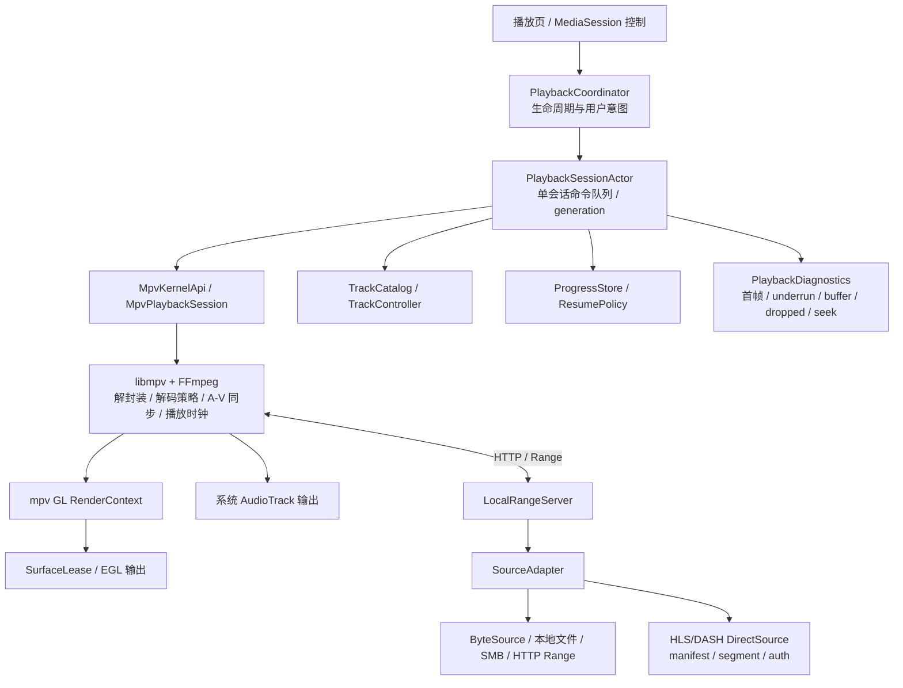
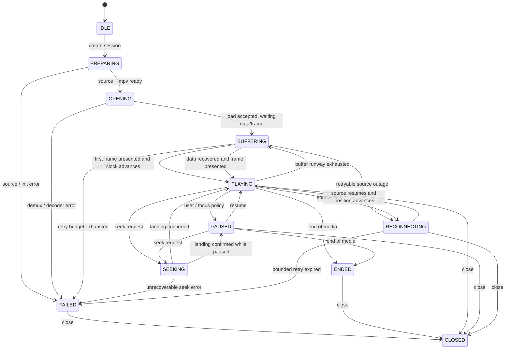
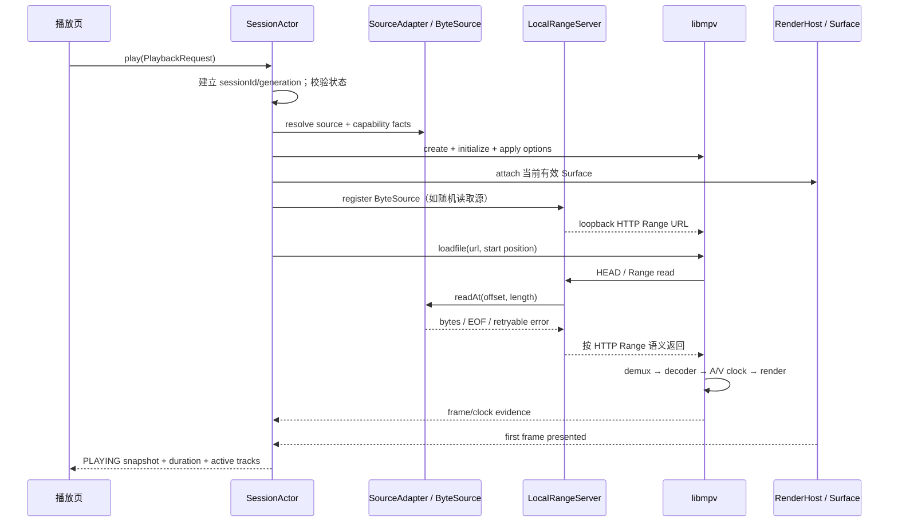

# 275 · SenPlayer 播放核心逆向结论与 Kivo 流畅播放设计

状态：**设计稿；未修改代码，未运行或安装 APK**  
范围：仅播放核心（会话、读源、解封装、解码、音视频同步、渲染、轨道、缓存、恢复与诊断）  
参考 APK：`SenPlayer-1.0.0-b11-Android-arm64-v8a.apk`  
APK SHA-256：`5b298aa118c9ea8b1e7615d38f42ab00452fc9cf1f248cb6f5facf83d1089963`

本文先记录 REA/JADX 可追溯的逆向结论，再给出 Kivo 可直接进入实现规划的播放核心设计。所有结论分为：**[静态确认]** APK 字节码/资源/ELF 清单中直接可见；**[结构推断]** 由调用关系推得但未在运行时观察；**[待验证]** 现有材料无法证明；**[Kivo 实测]** Kivo 现有真机证据；**[设计]** 本文建议。

“不卡”不是 APK 中一个可复制的开关，也不能由静态反编译证明。流畅播放取决于源站吞吐、读取等待、解封装前瞻、解码吞吐、Surface 呈现、音频时钟和设备热状态共同满足实时预算。本文把“复刻流畅核心”定义为：**每一次停顿都能被测量、定位到一个责任层、用可逆策略修复，并在相同片源和设备上复算**。本文不会把 SenPlayer 的字符串线索写成其运行时性能结论。

## 一、逆向分析结论

### 1.1 APK 与证据范围

REA 对目标 APK 的包信息、DEX 类、`com.mplaykit.Player`、播放器控制器、Activity 生命周期、播放状态对象和原生库条目做了静态分析。REA 记录的 JADX headless 版本为 0.7.1；APK 包名 `com.wuziqi.SenPlayer`，版本 `1.0.0` / code `11`，ABI 为 arm64。类清单记录 6549 个类。

**可确认的原生播放相关文件**包括 `lib/arm64-v8a/libMLibKit.so` 与 `lib/arm64-v8a/libFFmpegKit.so`。名字和包内存在性说明应用包含这两份 ELF；不能单凭名称确认二者的职责边界、FFmpeg 版本、编译选项、实际播放时是否走某个解码器，或是否使用 mpv。REA 对 native/JNI 的静态覆盖没有恢复出完整的 C++ 调用图。

本轮结论的主要边界是：**Java/Kotlin 控制面可以追踪；原生核心内部执行过程不能从现有材料逐函数还原。** 没有 APK 运行时跟踪、native 符号/源码或厂商运行日志，就不能声称已“完整拆解到每个 native 细节”。

### 1.2 SenPlayer 可追溯调用链

```mermaid
flowchart LR
    A[PlayerActivity / 播放控制器 up3] -->|构造参数 Surface / Display / 配置| B[com.mplaykit.Player]
    B -->|p(...)| C[N.n5(...)]
    C --> D[原生会话句柄 g]
    E[播放/暂停/属性命令] -->|e(...) 单线程 Executor| B
    E -->|G(...) 通用命令| F[N.n3(...)]
    G[seek A(seconds)] --> H[N.n16(handle, seconds, future)]
    I[Surface 更新 x(surface, surface2)] -->|同一 Executor 异步串行| J[原生 Surface 更新调用]
    K[状态 t() / 轨道 u(...)] --> F
    L[close / n()] -->|幂等 future；executor 顺序收尾| M[原生释放]
    N[BackgroundPlaybackService] -.生命周期支持线索.-> A
```

| 环节 | 可观察事实 | 职责判断 | 证据与边界 |
|---|---|---|---|
| 播放入口 | `PlayerActivity.onCreate` 建立播放上下文；混淆控制器 `defpackage.up3` 的反编译源码出现播放器构造、seek 与 Surface 更新调用 | Activity/controller 负责把输入、Surface 和用户命令交给播放器门面；`up3` 名称混淆，本文只按已见行为描述 | [S1][S2][S3]。不推测未还原的业务分支 |
| native 初始化 | `Player` 构造调用 `p(surface, surface2, display, options, previousHandle)`；`p(...)` 组装选项并调用 `N.n5(...)`，成功后返回非零句柄 | `Player` 是 native 会话的 Java 门面，`g` 是 native handle；两个 Surface、Display 与配置进入 native 初始化边界 | [S1][S4]。`N.n5` 之后的 native 初始化阶段不可见 |
| 命令串行化 | `Player` 持有 `Executors.newSingleThreadExecutor()`；`e(...)` 将 `N.n3(...)` 命令放进该执行器；`G(...)` 是通用命令入口 | 对外命令采用单会话顺序队列，避免控制命令并发改写 native 状态 | [S1][S5]。不表示解码、网络或渲染也在该线程执行 |
| seek | `A(double)` 检查 handle，再调用 `N.n16(handle, seconds, future)` 并返回 `CompletableFuture` | seek 是异步 native 操作，时间单位在 Java 门面处为秒 | [S1][S6]。落点精度、seek 模式、音视频 flush 顺序未知 |
| Surface 更新 | `x(surface, surface2)` 检查 handle 后提交给单线程 executor | Surface 更新与普通控制命令共享一个串行入口，至少 Java 侧避免并发调用 | [S1][S7]。native 是否重建 EGL/解码器、双 Surface 含义、空 Surface 语义未知 |
| 状态与轨道 | `t()` 返回 `CompletableFuture` 状态；`u(trackCommand)` 走轨道命令；`G(...)` 支持一般命令参数 | 状态与轨道控制通过统一 native 命令层暴露 | [S1][S8]。内部状态字段、轨道选择优先级和回读一致性未知 |
| 释放 | `n()` 缓存关闭 future；先把 `g` 清零，再在同一 executor 上运行释放任务并 `shutdown()`；重复关闭返回同一 future | 句柄清零和 future 缓存让关闭具备幂等入口；串行队列使此前命令先于释放执行 | [S1][S9]。native 资源释放顺序细节未知 |
| Activity/后台生命周期 | `PlayerActivity` 有 `onResume/onPause/onStop/onDestroy`；`BackgroundPlaybackService.onCreate` 建立后台播放服务 | 前台页面和后台播放服务至少在结构上分开 | [S10][S11]。现有静态材料不足以证明 Activity 销毁后会话必然存活，或各生命周期回调实际触发何种暂停策略 |

### 1.3 解码、渲染、同步：已知与未知

REA 解出的字符串可见 `hwdec`、`hwdecCurrent`、`mediacodec`、`hwdec-software-fallback`、`cache-dir`、`cache-capacity`、`cacheRanges`、`cacheDuration`、`cacheEnd`、`cacheEOF`、`video-frame-interpolation` 等词。Java 的初始化选项表也出现与硬件解码相关的配置键。

这些证据只能证明播放器控制面包含这些名字，不能证明某项设置确实成功写入、运行时选择了 MediaCodec、软件回退是否启用、缓存的读写策略、插帧是否参与呈现，或任何选项的默认值。因此：

| 子系统 | 可确认 | 尚不能确认 |
|---|---|---|
| 解码 | 有硬解配置名和 MediaCodec 相关字符串；存在原生播放库 | 硬解/软解选择顺序、设备能力探测、profile/位深限制、10-bit 回退、失败恢复流程、实际 decoder 名称 |
| Surface/纹理 | Surface 与 Display 被传到 native 创建入口；Java 提供 Surface 更新方法 | Surface 是否直接交 MediaCodec、是否经过 SurfaceTexture/EGL、是否零拷贝、纹理所有权和切换重建路径 |
| 音视频同步 | 播放状态和音轨控制入口存在 | 主时钟来源、音频设备延迟校正、PTS 映射、迟到帧丢弃阈值、时钟漂移与 seek 后重基准策略 |
| 缓存 | 缓存容量/区间/时长/EOF 名称出现在解密字符串中 | 前向缓存量、读缓存算法、内存上限、预读优先级、磁盘缓存、断网保持时间 |
| 平滑播放成因 | 无静态材料能直接证明 | 无法从 APK 静态材料证明帧率稳定、卡顿率、首帧速度或其因果 |

原生边界和配置字符串对应证据为 [S1][S12][S13]。原生 ELF 的清单证据为 [S14]。

### 1.4 协议、ABR、音轨与字幕

| 范围 | 逆向结论 | 证据等级 |
|---|---|---|
| HTTP/网络输入 | 播放字符串与通用 native 命令中可见网络/缓存相关词；但没有足够证据还原 HTTP 请求栈、Range 行为、鉴权和重连 | **待验证** [S12][S13] |
| MP4 / MKV 等容器 | APK 携带 `libFFmpegKit.so` 是 FFmpeg 生态线索；不能由此单独确认每种容器都能播放，也不能确认走 FFmpeg 的全部媒体路径 | **待验证** [S14] |
| HLS / DASH | 现有可追溯记录没有证明其 manifest、分片和变体切换链路 | **待验证**；不得宣称支持或支持 ABR |
| 自适应码率 | 没有证据指出吞吐估计、buffer rule、切换阈值、升降档迟滞或切换时机 | **未还原** |
| 音轨 | `u(...)` 轨道命令入口，以及 `audioId` / `audioTrackId` 等解密字段 | 有轨道控制面线索，轨道枚举/语言匹配/无缝切换细节未知 [S1][S13] |
| 字幕 | 存在 subtitle 命令与导入相关字段/字符串，可见 subtitle policy 事件文本 | 有字幕控制面线索；格式、渲染层、ASS/位图字幕、同步和切轨流程未知 [S12][S13] |
| 多语言优选 | 有轨道 ID、语言/字幕控制相关字符串 | 自动选轨规则、locale 匹配优先级、用户覆盖持久化方式未知 [S13] |

结论：**SenPlayer 的播放控制面确实是原生核心的薄门面，但其解码器、渲染器、ABR、缓存和同步实现没有被当前静态证据完全穿透。** 将未知项作为设计输入，比用字符串脑补实现更可靠。

### 1.5 第三方组件与版本

| APK 组件 | 证据 | 版本结论 |
|---|---|---|
| `libMLibKit.so`（arm64-v8a） | APK ELF 清单 | 版本、内部职责和与播放器的调用关系**未知** |
| `libFFmpegKit.so`（arm64-v8a） | APK ELF 清单 | 可确认文件存在；FFmpeg/FFmpegKit 具体版本与编译配置**未知** |
| JADX headless / REA | REA 分析器元数据 | JADX 0.7.1；这是分析工具版本，不是 SenPlayer 运行时依赖版本 |
| SenPlayer 播放内核 | `com.mplaykit.Player` 与 JNI `N` 类 | 具体内核名称/版本**未知**；不能据此认定为 mpv、ExoPlayer、ijkplayer 或某特定 FFmpeg 版本 |

APK 的 `classes.dex`/ELF 只能提供组件定位线索。第三方版本若无 ELF build-id、版本字符串、依赖元数据或可验证符号，必须保持未知。[S14]

### 1.6 补充（2026-11-18）：SMB 读取层与"本地缓存文件"通路

> **本节修正两处**：① 2026-11-15 的会话笔记里写过"SenPlayer 的 mpv 静态链含 libsmb2"
> ——**不准确**，实际是 Rust 的 SMBKit；② 本次初次分析时我用了 `strings`，
> 而本机 Git Bash **没有 strings**（命令静默失败），据此得出的"so 里没有 smb"
> 是**假结论**。改用 Python 直接对二进制做字节计数与可打印字符串提取后重做，结果如下。

**字节计数（`open(p,'rb').read().count(b'...')`）**

| 关键词 | `libFFmpegKit.so`（52.8 MB） | `libMLibKit.so`（15.8 MB） |
|---|---:|---:|
| `smb` | 124 | 142 |
| `SMB` | 560 | 580 |
| `mpv` | 17 | 1 |
| `libass` | 32 | 0 |
| `gpu-next` | 1 | 0 |

**字符串证据（去重后 583 / 615 条含 smb）**

```
../../SMBKit/client/mod.rs
../../SMBKit/client/operations.rs
../../SMBKit/client/transfer.rs
../../SMBKit/reader.rs
../../SMBKit/rules.rs
Cannot flush local SMB download
Cannot open local SMB transfer file
Cannot seek SMB file
Invalid SMB cursor
Failed to open smb2 socket. Errno:%s(%d).
```

**判读（证据等级：强推断，未做运行时跟踪）**

- `../../SMBKit/*.rs` 是 **Rust 源码路径** ⇒ SMB 客户端是 Rust 实现的 `SMBKit`，
  不是 libsmb2 的 Kotlin/Java 绑定；`Failed to open smb2 socket` 这类 libsmb2 文案
  说明它**参考或内联**了 libsmb2 的部分实现。
- `local SMB download` / `local SMB transfer file` / `Invalid SMB cursor` 三条合起来，
  配合 §1.3 已记录的 `cache-dir` / `cache-capacity` / `cacheRanges` / `cacheEnd` / `cacheEOF`，
  指向一个具体形态：**SMB 数据被下载进本地缓存文件（稀疏、按区间填充），
  mpv 读的是这个本地文件，而不是 SMB URL、也不是 loopback HTTP。**
- 两条通道的含义完全不同：

| | SenPlayer（据上述证据） | Kivo（现状，见 §3.1） |
|---|---|---|
| mpv 读什么 | 磁盘上的缓存文件路径 | `http://127.0.0.1:<port>/…` |
| 格式识别由谁做 | ffmpeg 嗅探 + 真实扩展名 | ffmpeg 嗅探，但**受响应头 `Content-Type` 影响** |
| 代价 | 需要磁盘空间与稀疏文件管理 | 多一层 socket，且**必须把 content-type 答对** |

这解释了 2026-11-18 在 Kivo 侧定位的那个缺陷（`D12I`）：我们把
`Content-Type` 写死成 `video/x-matroska`，导致所有 `.ts` 播不了；
SenPlayer 的通道里**根本没有这条契约**，所以它不会踩。

**边界**：以上是静态字符串 + 既有字段名的一致性推断，**没有做运行时跟踪**，
不能确认稀疏文件的具体写入策略、补块粒度、cache 上限行为，也不能确认它是否
对所有源都走同一条通路（本地文件、HTTP、WebDAV 可能各有分支）。

## 二、Kivo 现状与复刻判断

### 2.1 Kivo 已有的可复用播放骨架

Kivo 已经把 libmpv 接入真实播放页：`MpvStartSequence` 负责创建内核、应用策略、绑定 Surface、注册本地 Range URL、加载资源并等待真实首帧；`MpvPlaybackSession` 管会话状态、位置轮询、暂停、seek、Surface 重绑和释放；`LocalRangeServer` 将 `ByteSource.readAt` 暴露为 loopback HTTP Range；JNI/C++ 侧分别封装 session、命令、GL 渲染和 Surface。

Kivo 在 K40 上的 P253 证据确认 libmpv 0.39.0、FFmpeg 7.1、libplacebo 7.391；一段 12.19 GB 的 HEVC 10-bit + TrueHD 文件实际通过 `mediacodec-copy` 硬解，播放页画面与位置推进，seek 可落到目标附近，长断网恢复后位置继续推进。该证据是特定设备、片源和实现版本上的事实，不等于所有媒体/设备均流畅。[K1]

Kivo 当前真实网络链路有一个不能忽略的归因教训：P274 记录的 4K 源码率约 6.7 MB/s，而单连接读取约 2.16 MB/s，播放只有 1.53 fps，CPU 占用低且使用硬解。这说明本项目已遇到“网络供数慢导致画面停顿”的实证案例，不能把播放卡顿一律归给 decoder。P274 的并发预读仍是设计/WIP，具体增益须以同源真机复验为准。[K2]

### 2.2 复刻路线判决

**不从 SenPlayer 的 opaque native library 猜写一套解码核心。** Kivo 已有 libmpv 真机闭环，建议以 libmpv 为唯一播放时序与媒体处理核心，Kotlin/C++ 负责会话编排、数据源适配、Surface 生命周期和诊断；逐层补齐证据缺口。这样保留成熟的容器/编解码/同步管线，避免同时维护两套 demux、clock、A/V sync 和 renderer。

对 SenPlayer 的“复刻”目标应落在可观察行为：单播放器会话、串行状态变更、异步命令、稳定 seek、硬解优先、Surface 可恢复、轨道切换、断网容错和可诊断缓存。具体内部算法只有取得动态证据后才可声称复刻。

## 三、目标架构

### 3.1 架构图



**边界原则：**

1. libmpv 作为唯一媒体时钟所有者，解封装、音视频队列、同步和呈现节拍由内核统一协调。Kotlin 不再另起第二套 A/V 同步器。
2. `PlaybackSessionActor` 是会话状态唯一写者。seek、换轨、暂停、load、Surface 变化和释放都带 `sessionId + generation`，旧异步结果不得覆盖新播放。
3. `SourceAdapter` 只解决字节/流如何到达内核，不决定视频帧何时显示；播放内核只消费协议，不直接拥有 SMB/本地业务凭据。
4. Surface 是可重建输出资源，不是播放会话本身。Activity 重建或播放器视图 detach 不应隐式销毁媒体会话。
5. 每个自动策略都写入诊断：选了哪条 source、decoder、缓冲目标、轨道和 ABR representation，以及为何切换。

### 3.2 模块职责与家族树

以下是设计边界，不要求为每个节点机械新增文件。优先沿用现有文件；只有独立变化原因和独立测试边界成立时再拆新文件。

```text
android/app/src/main/java/com/kivo/cinema/
├─ playback/
│  ├─ PlaybackCoordinator.kt       # 用户意图与 Activity/Service 生命周期协调
│  ├─ PlaybackSessionActor.kt      # 建议边界：会话单写者、命令顺序、generation 取消
│  ├─ MpvPlaybackSession.kt        # 现有：一个 native 会话的状态与公开操作
│  ├─ MpvStartSequence.kt          # 现有：初始化顺序、策略与首帧门槛
│  ├─ MpvSeekControl.kt            # 现有：seek 请求/落点控制
│  ├─ MpvFirstFrameWait.kt         # 现有：真正上屏首帧确认
│  ├─ MpvTrackCatalog.kt            # 现有：轨道元数据映射
│  ├─ MpvSubtitleControl.kt         # 现有：字幕控制
│  ├─ PlaybackProgressStore.kt      # 建议边界：节流保存、恢复点与内容键
│  └─ PlaybackDiagnostics.kt        # 建议边界：分段时延、卡顿原因、状态事件
├─ mpv/
│  ├─ MpvNative.kt                  # 现有 JNI 契约
│  ├─ LocalRangeServer.kt            # 现有 loopback HTTP Range 代理
│  ├─ LocalRangeResponder.kt         # 现有 Range 请求语义
│  └─ MpvRenderHost.kt               # 建议命名边界：Surface/EGL attach、detach、恢复
└─ net/
   ├─ ByteSource.kt                  # 现有随机读取抽象
   ├─ OriginPrefetchPump.kt          # 现有源站供数/预读
   └─ SourceAdapter.kt               # 建议边界：本地、Range 文件与直播清单的选路

android/app/src/main/cpp/mpv/
├─ mpv_session.*                     # native handle 和 mpv 生命周期
├─ mpv_event_loop.*                  # mpv wakeup/event 响应
├─ mpv_commands.*                    # 属性、seek、轨道等命令
├─ mpv_video_output.*                # 视频输出资源所有权
├─ mpv_gl_render.cpp                 # mpv render API 到 EGL/GL
└─ jni_mpv_*_bridge.cpp              # JNI 参数校验与异常转译
```

现有 Kivo 代码依据：`MpvPlaybackSession.kt`、`MpvStartSequence.kt`、`MpvSeekControl.kt`、`MpvFirstFrameWait.kt`、`LocalRangeServer.kt`、`mpv_session.*`、`mpv_event_loop.cpp`、`mpv_commands.cpp`、`mpv_gl_render.cpp`。[K3][K4]

### 3.3 核心接口与数据契约

| 接口/结构 | 关键字段/方法 | 契约 |
|---|---|---|
| `PlaybackRequest` | `contentKey`, `source`, `startUs`, `audioLanguagePrefs`, `subtitleLanguagePrefs`, `resumePolicy` | 只包含本轮播放决策所需数据；凭据不进入 URL、日志或诊断 JSON |
| `PlaybackSession` | `sessionId`, `generation`, `state`, `play/pause/seek/selectTrack/rebindSurface/close` | 所有可变命令通过 actor；关闭幂等；旧 generation 的回调丢弃 |
| `PlaybackSnapshot` | `positionUs`, `durationUs?`, `isPaused`, `bufferAheadUs?`, `videoFps?`, `activeTracks`, `decoder`, `surfaceState` | 读不到就为 unknown/null，禁止填默认值伪装健康 |
| `SourceDescriptor` | `kind`, `canonicalId`, `uri?`, `byteSource?`, `supportsRange`, `knownLength?`, `authRef?` | 容器、传输协议、来源类型分离；MP4 是容器，不是网络协议 |
| `ReadResult` | `bytesRead`, `eof`, `retryable`, `errorCode`, `reason`, `elapsedNs` | EOF、短读、暂时断网和永久拒绝必须可区分；读失败不能伪装 EOF |
| `TrackDescriptor` | `id`, `type`, `codec`, `language?`, `title?`, `isDefault`, `isExternal`, `isSelected` | ID 以当前媒体 generation 为作用域；切媒体后旧 ID 作废 |
| `PlaybackError` | `domain`, `code`, `stage`, `retryable`, `userReason`, `causeSummary` | reason 非空；native 原始错误保留到诊断层，UI 映射为可理解提示 |
| `PlaybackMetrics` | `startupStages`, `renderGap`, `buffering`, `seek`, `read`, `decode`, `surface`, `audio` | 记录样本口径、时间基准、来源与设备；不把不可测记成 0 |

### 3.4 线程模型与所有权

| 执行域 | 唯一职责 | 禁止事项 |
|---|---|---|
| Main/UI | 用户输入、展示快照、绑定/解绑 view | 不做同步 seek、不等待首帧、不做网络读或 native close |
| Session actor | 接收并排序控制操作，分配 generation，汇总结果 | 不跑阻塞 I/O、不持有 Compose View |
| libmpv 内部 demux/read/decode/audio 线程 | 内核自己的媒体管线与同步 | Kotlin 不与其争夺时钟、不从旁再造帧队列 |
| Source I/O executor | `ByteSource.readAt`、连接恢复、受限并发预取 | 不持有 Surface，不把 EOF 当网络错误，不无限增长并发 |
| GL/render callback | 按 mpv render API 要求提交帧 | 不读回像素、不做网络或磁盘 I/O、不跨线程释放 EGL 资源 |
| Diagnostics | 低开销计数与异步落盘 | 不阻塞呈现线程；采样必须可关闭且有上限 |

Native session、render context 和输出窗口必须有单一所有者。创建失败和正常关闭均按逆序释放：停止新命令 → 取消/等待正在进行的 I/O → 解除 render callback → 销毁 render context/EGL → 销毁 mpv handle → 释放 proxy/source。任何阶段超时都留下资源状态和 reason，不能静默略过。

### 3.5 播放状态机



`PLAYING` 的判据必须同时满足：已观察到有效视频帧呈现（音频-only 资源则为有效音频推进）且媒体时钟前进。仅 `loadFile` 成功、duration 已知或 position 属性非零都不能代表用户已看到/听到媒体。`BUFFERING` 表示播放时钟因供数/解码/输出不足而无法持续推进；`RECONNECTING` 只代表可重试的源错误，不替代缓冲状态。

## 四、关键时序

### 4.1 起播与首帧



**起播阶段必须分段计时**：用户点击 → session 创建 → source ready → 网络首响应头 → `loadfile` 到 demux open → 首个解码帧 → 首帧真正呈现。每个等待都带 owner 与 timeout。预热可以缩短等待，但不能成为播放的硬依赖；预热超时必须继续走正常打开路径。

### 4.2 Seek 与恢复

1. actor 递增操作序号并把状态置为 `SEEKING`；快速拖动采用“最新目标优先”，取消或合并过期 seek，避免旧落点覆盖新目标。
2. 内核执行带明确精度语义的 seek；在收到新媒体时间、目标附近的视频帧呈现与音频时钟恢复前，不宣告 seek 完成。
3. 记录 `requestedUs`、`landingUs`、首个稳定帧时间、前后缓冲量和误差；失败保留旧播放位置或明确进入错误态，不伪造请求位置为落点。
4. seek 成功后才更新持久恢复点；若暂停状态 seek，落点确认后仍保持暂停。

Kivo 的 P253 实测 mpv seek 到 600 s 后落点约 600.14–600.73 s；同一证据也记载旧内核按 GOP 落点可能偏差数秒。这是 Kivo 当前可用的复用基础，不证明任意容器或稀疏索引都能达到同一精度。[K1]

### 4.3 Surface 生命周期

Activity/View 生命周期只拥有 Surface 引用；播放服务/Session 持有媒体会话。Surface 进入 `ATTACHING → ATTACHED → DETACHING → DETACHED/REBUILDING` 独立状态机，不能用 `PlaybackState` 代替。重绑 Surface 时不得无意触发第二次 `loadfile`、丢失播放位置或释放仍被 native 使用的窗口。

仓库的 P12-D1 在 Redmi K40 上测到 MediaCodec `setOutputSurface(nullptr)` 后不能可靠切回 Surface，因此旧后端采用本地摘面标记并保留 `ANativeWindow*`。这条是 Android Surface 风险的强证据，但**不直接等于 libmpv 的 EGL 路径必然具有相同行为**；mpv 路径要单独验 attach/detach、Activity 重建、后台续播与窗口引用释放。[K5]

## 五、流畅性策略

### 5.1 解码选择与降级

1. 打开媒体前收集设备/MediaCodec 能力、视频 codec/profile/level/尺寸/位深/HDR 元数据、音频输出能力和 Surface 状态；分辨“能力未知”和“不支持”。
2. 默认选择可用的硬件解码路径并把实际 decoder 名称、配置结果、是否 copy、输出格式写入 session 诊断。
3. 配置失败时只有在格式策略允许、用户可见且能说明性能/画质影响时才回退。按仓库铁律，10-bit 软解回退禁止；不允许把“降到 8-bit/软解后继续”伪装成成功。
4. 不能把 decoder 启动成功等同于实时能力足够。用解码时间/帧间隔/丢帧/热状态评估持续吞吐，区分硬解有帧但网络无数据、解码跟不上和 Surface 呈现落后的情况。

证据：SenPlayer 的 `hwdec`/`mediacodec` 字符串只形成待验证线索 [S12][S13]；Kivo 已有 MediaCodec 硬解与 4K/10-bit 真机经验和“不静默降级”铁律 [K1][K6]。本节是 Kivo 设计，不是对 SenPlayer 运行时的断言。

### 5.2 网络供数、缓存与断网

缓存必须按**时间 runway**和**内存字节**双重衡量：`bufferAheadUs` 说明还能播多久，`bufferBytes` 说明占用多少内存。用媒体实测码率估算 runway；平均码率不代表峰值，需保留突发余量。起播/seek/播放中读取采用不同优先级：当前解码所需字节 > seek 落点窗口 > 短时前瞻 > 低优先级预取。

源读取契约要求随机访问可明确返回短读、EOF、临时失败和永久失败。Range 回答必须与请求 offset/length 一致；重复区间可共享在途请求/缓存，seek 时取消无关预取并提高落点邻域优先级。并发预读只在同源真机数据证明源站允许叠加带宽后启用；限制总连接数、最大驻留字节和每请求超时，并提供可逆回退。P274 已记录主链路吞吐不足导致 4K 播放极慢，正好说明缓存不能替代源吞吐，也不能无限增大 demux 缓冲。[K2]

断网路径分两层：Source 层对明确可恢复的网络错误做有界等待/重试；引擎层保留未消费缓存，在超过缓存 runway 后报告 `BUFFERING/RECONNECTING`。恢复时从准确 byte offset 或内核新 Range 请求续读；只有源站拒绝、认证失效、文件消失或重试预算耗尽才进入终止错误。HTTP 状态码、SMB 错误码、读超时不能映射成 EOF。

### 5.3 HLS / DASH / MP4 与 ABR 设计目标

容器、传输协议和自适应 manifest 是三个维度：MP4/MKV 是容器；HTTP/SMB 是读取方式；HLS/DASH 提供分片与可能的多 representation。媒体引擎可以统一解码呈现，但 source adapter 必须保留各自的认证、Range、重连和缓存语义。

| 类型 | Source 设计 | ABR 设计 | 当前 Kivo 状态 |
|---|---|---|---|
| 本地 MP4/MKV | 本地随机读或文件 URI；容器索引/seek 由 libmpv/FFmpeg 处理 | 单文件无 representation 时不做 ABR | mpv/SMB 真实播放已验证；完整格式矩阵未在本文复测 |
| HTTP Range 文件 | `ByteSource.readAt` 经 LocalRangeServer；保持正确 Content-Length/206/EOF | 单文件不做 ABR | 当前有代理实现；需逐源验证 Range 与并发策略 |
| HLS | manifest + segment 由引擎或专用 source 按统一鉴权配置获取 | 若 manifest 有多档，优先由同一播放引擎管理 representation，避免外部 ABR 与引擎互相打架 | SenPlayer 静态证据未确认；Kivo 未在 P253 证据中确认 |
| DASH | MPD + segment 模板/时间线/加密信息由引擎协议栈处理 | 同 HLS：读取吞吐、buffer runway、codec/分辨率能力共同决定 | SenPlayer 静态证据未确认；Kivo 未在 P253 证据中确认 |
| SMB/WebDAV/Emby 文件 | 继续复用 Kivo ByteSource/鉴权/重连层，经 range adapter 喂给 mpv | 文件本身通常固定码率，瓶颈是读取能力，不是 representation 选择 | SMB 路径已有真机闭环；其他来源需分别留证 |

**ABR 目标算法（仅针对多 representation 的 HLS/DASH）**：每个 segment 采样有效吞吐，使用 EWMA 抑制单段波动；可选 representation 的峰值带宽必须低于安全吞吐预算，并同时满足设备 decoder profile、屏幕分辨率和 buffer runway。升档要求连续多个窗口达到余量，降档在 buffer runway 逼近下限或连续吞吐不足时快速执行；设最短驻留时间和升降档不同阈值，降低振荡。切档原因、前后 representation、估计带宽、buffer 变化必须可观测。**先验证所选引擎实际支持相应 HLS/DASH 变体，再实施 ABR；不能因为 APK 中有 FFmpeg 命名库就宣称支持。**

### 5.4 音视频同步、轨道与进度

- libmpv 是音视频同步和媒体时钟唯一 owner；普通含音频媒体优先跟随引擎的音频播放时钟，纯视频由引擎 monotonic clock 管理。Kotlin UI 只读取快照。
- audio/subtitle language preference 在 `loadfile` 前应用；媒体打开后从真实 `track-list` 构建 catalog，切换后回读 selected 状态。无法取得语言标签时显示“未知”，不可假设为系统语言。
- 轨道 ID 限定在 `generation` 内。切换媒体、重新打开或 seek 导致轨道重建时重新枚举，避免旧 ID 命中新轨。
- 外挂字幕由字幕控制层挂载并校验格式/编码/路径；位图字幕、ASS 特效和渲染成功须按真实画面验证。PGS 位图 / SRT 文本 / ASS 特效三类字幕链路已在 D303 按真实画面闭环（K40 gpu-next 路径），本条不再是未完成项；但新增字幕能力仍须按真实画面验证，不得仅凭配置声称可用。[K7]（`docs/evidence/p303-subtitle-close/status.md`）
- 恢复点以稳定内容标识（规范化源 ID + 媒体标识）为键，保存媒体时间而非 byte offset；按固定间隔、暂停、seek 成功、后台离开和播放结束落盘，写入节流且原子替换。读取恢复点后由引擎按索引定位，不能自行假设目标恰好在关键帧。

### 5.5 错误与用户可见降级

| 错误域 | 示例 | 是否重试 | 必须保留的信息 |
|---|---|---|---|
| `SOURCE` | DNS/连接/SMB 授权/HTTP 401、403、404、5xx、Range 不一致 | 网络瞬断可有界重试；授权和不存在不盲重试 | 协议、远端状态、offset、耗时、重试次数、用户可读 reason |
| `DEMUX` | 不支持容器、损坏索引、缺轨 | 通常不重试；仅可重新打开一次已更新源 | 容器猜测与实际 demuxer、轨道枚举结果 |
| `DECODER` | codec/profile 不支持、硬解配置失败、运行中输出错误 | 仅按明确策略重试另一允许路径 | decoder 名称、配置参数、位深/HDR、回退策略与原因 |
| `RENDER` | Surface 无效、EGL/context 丢失、呈现不推进 | Surface 重建可限次恢复 | Surface generation、context 状态、首帧/末帧时刻 |
| `AUDIO` | 输出设备失效、格式不支持、AudioTrack 错误 | 可重建音频设备；不得破坏视频会话状态 | sample rate/channel layout、设备变化、clock source |
| `SEEK` | 定位超时、无有效落点、连续拖动过期 | 合并旧 seek；对有效目标有限重试 | requested/landing/first-frame 时间、精度模式 |
| `RESOURCE` | 内存上限、native handle 泄漏、释放超时 | 不盲目继续创建新 session | heap、buffer lease、在途任务和关闭阶段 |

错误对象总是携带非空 reason、阶段、是否可重试和诊断关联 ID。可恢复降级必须明确显示实际状态，例如“当前设备不支持此 10-bit 格式”，不能仅显示黑屏或无限 loading。

## 六、验收方案：把“不卡”变成可复算指标

### 6.1 每次播放必须采的阶段量

| 指标 | 起止点 / 口径 | 目的 |
|---|---|---|
| `startup_total_ms` | 用户确认播放 → 有效首帧实际呈现（音频-only 取首个有效音频时钟推进） | 用户感知起播 |
| `open_ms` | `loadfile` → demux/轨道可用 | 分离容器探测与 source 等待 |
| `first_decode_ms` | `loadfile` → 第一帧解码完成 | 分离 decoder 启动成本 |
| `first_present_ms` | 第一帧解码 → Surface 呈现 | 分离 render/Surface 成本 |
| `read_latency_ms` | 每次 readAt / HTTP Range 的队列等待、连接、首字节、完成耗时 | 定位网络等待与重复下载 |
| `buffer_runway_ms` | 前向媒体数据可播放时长 | 判断是否供数不足 |
| `render_gap_ms` | 实际相邻呈现时间间隔分布、p50/p95/p99/max | 量化卡顿和长尾，不用平均 FPS 掩盖 freeze |
| `frames_dropped` | 迟到丢帧、无 Surface 丢帧和解码丢帧分列 | 归因丢帧来源 |
| `seek_total_ms` | 用户 seek 请求 → 首帧稳定落位 | 量化 seek 响应 |
| `network_recovery_ms` | 网络恢复 → 媒体时钟再次前进 | 区分缓存掩盖和真实恢复 |
| `thermal_context` | 温度/降频或系统热状态采样（可用时） | 解释长时间性能衰减 |

每条数据必须带设备/SoC/Android、片源 hash、codec/profile/位深/HDR、分辨率/帧率/码率、来源协议、网络条件、内核版本、实际 decoder、渲染 Surface 状态、缓存策略和证据文件。没有采样的字段写 `not_measured + reason`；不能用 0 表示未知。

### 6.2 首轮验收矩阵与建议门槛

门槛先用于 K40 基线，再扩展第二 SoC；同源、同网络、同温度窗口 A/B。下表标“目标”的数值是**Kivo 设计验收目标**，不是 SenPlayer 测量结果。

| 场景 | 关键通过条件 |
|---|---|
| 本地/局域网 1080p 24/30 fps SDR | 10 分钟连续播放无可见 freeze；稳态呈现间隔 p99 不超过 2 个目标帧周期；无持续解码积压 |
| 本地/局域网 4K HEVC 10-bit | 确认实际硬解；软解不静默接管；10 分钟长稳无持续热降频导致的失速；HDR 元数据按素材能力验证 |
| 网络 1080p 文件 | 缓冲次数 ≤1 / 10 min；若触发必须能归因到 source / decoder / renderer；前向 runway 与源吞吐数据留档 |
| 高码率 4K 文件 | source 有效吞吐持续大于媒体实时需求并有安全余量；若源站能力不足，明确显示供数瓶颈，不能通过增大缓存宣称修复 |
| 冷起播 / 预热起播 | 分开测冷路径和真实用户预热路径；P95 目标 ≤3 s 仅适用于源站可用、局域网稳定且片源索引正常的定义场景，先采真实入口基线再定默认门槛 |
| Seek / 快速拖动 | 连续 20 次 seek 无旧请求覆盖新目标；落点误差/响应时间分别记录；暂停状态不被误启动 |
| 断网 60 s 后恢复 | 缓存 runway 用尽后进入清楚的 buffering/reconnecting；网络回来后有界恢复且位置不倒退、不跳到 EOF |
| Surface/Activity 重建 | 100 次前后台或视图重建无 native crash/泄漏；重绑后播放继续；按 libmpv 路径独立验证，不借用旧 MediaCodec 结论 |
| HLS / DASH | 多 representation 切换时无 ABR 振荡；切换无明显黑帧；验证 manifest、segment、鉴权、seek 与网络恢复完整链路 |
| 音轨/字幕 | track catalog 与内核回读一致；语言优选、手动覆盖、外挂字幕和 seek 同步分别验证；PGS/ASS 单列结果 |

使用 Redmi K40 `b6e950ee` 作为既有回归设备，但“模拟器结果不能代替真实硬件证据”。先完成 K40 的路径归因与长稳，再做不同 SoC/厂商 Surface 和 codec 能力矩阵。[K6]

## 七、设计决策与逆向证据追溯

| 决策 | SenPlayer 依据 | Kivo 依据 | 设计结论 |
|---|---|---|---|
| 一个 session 一个 native handle；close 幂等 | `Player.g`、`n()` 缓存关闭 future、清零 handle [S1][S9] | `MpvPlaybackSession` 与 native session table [K3][K4] | 明确 handle 所有权和 close 状态；重复关闭返回同一结果 |
| 所有会改会话状态的命令串行化 | `Player.o` 单线程 executor；`e/x/n` 复用该 executor [S1][S5][S7][S9] | 现有 `MpvPlaybackSession` 状态与 JNI session lock [K3][K4] | 用 actor 作为单写者，I/O/render 不进 actor 阻塞 |
| seek 必须异步且反馈真实落点 | `A(double)` 返回 future 并转给 `N.n16` [S1][S6] | `MpvSeekControl`、P253 seek 结果 [K1][K3] | 请求值与落点分开记录；只有新帧与时钟确认后才完成 |
| Surface 与媒体 session 分开管理 | constructor / `x(surface,surface2)` 暴露 Surface 边界 [S1][S4][S7] | P12-D1 Surface 行为与 mpv render 资源所有权经验 [K5] | Surface 作为可重建输出 lease；mpv EGL 行为独立验证 |
| 硬解行为要记录实际选择，而不能只记配置 | SenPlayer 仅有 hwdec/mediacodec 字符串，无法证明运行时结果 [S12][S13] | Kivo 日志实见 `mediacodec-copy` [K1] | decoder/配置结果/回退原因成为必采字段 |
| 不卡顿优先按数据定位供数、解码、呈现 | 静态 APK 无性能因果证据 [S12][S13] | P274 测得网络吞吐不足、低 CPU、低帧率 [K2] | 每层独立采样；禁止把所有停顿归为解码器 |
| HLS/DASH 和 ABR 不能靠库名认定 | APK 仅可定位 FFmpeg 命名 ELF，版本和运行时路径未知 [S14] | Kivo P253 范围未覆盖 HLS/DASH [K1] | 先验证协议能力，再做 ABR；单文件 MP4 不做虚构 ABR |
| 字幕能力按格式与画面结果验收 | 只确认 subtitle 控制字符串与 track command [S1][S13] | Kivo PGS/SRT/ASS 已在 D303 按画面闭环 [K7] | 每种字幕格式独立验证解码/渲染/同步，不把轨道存在当成显示成功 |
| 诊断与用户错误必须非空且可复算 | SenPlayer 当前静态证据未还原完整错误码 [S12][S13] | 仓库铁律“不许静默降级”、P12 证据体系 [K6] | 使用稳定错误域与 reason，未知状态保留 unknown |

## 八、实施顺序与退出条件

本文件只完成设计，不进入代码实现。建议后续按以下顺序开卡，每阶段的结果必须由 K40 真机证据支持：

1. **播放基线与事件口径**：先在真实用户入口采首帧、read、buffer runway、render gap、decoder 和 Surface 事实；确认探针不会改变路径。
2. **会话 actor / generation 收敛**：把 start、seek、track、surface、close 串成单写者协议，覆盖快速 seek、切片、重复 close、Activity 重建。
3. **Source 读取预算**：拆分冷连接、重复 Range、短读、连接复用、prefetch 竞争和内存占用；任何并发优化先有同源 A/B。
4. **硬解/格式能力矩阵**：按 codec/profile/bit depth/HDR/尺寸验证 MediaCodec 与 libmpv 选择，明确不可用时的用户提示和拒绝策略。
5. **生命周期和断网长稳**：至少 30 分钟播放、60 秒断网、反复 Surface 重建，保留原始诊断和可复算 summary。
6. **HLS/DASH 与 ABR**：只有 build 中协议和 representation 被实测确认后再立独立实现卡；先覆盖单 representation，再测升降档和 seek/断网。
7. **字幕/音轨闭环**：轨道回读、语言优选、外挂字幕、ASS/PGS、seek 后同步按种类验收。

退出条件是：指定设备与片源矩阵内，起播、播放中间隔、seek、buffering、断网恢复、Surface 重建都达到已声明指标；每次例外都有非空 reason；证据可由第三方复算。超出设备/协议/片源覆盖矩阵的能力写成“未验证”，不能宣称“完美支持”。

## 九、证据索引

### SenPlayer / REA 静态证据

- [S1 · `Player` 类反编译与方法表](../../evidence/senplayer-b11/playback-core/32-player-source.json)：`com.mplaykit.Player` 构造、句柄、executor、命令、seek、Surface、状态和 close。
- [S2 · `up3` 控制器反编译源码](../../evidence/senplayer-b11/playback-core/35-controller-up3-decompiled.java)：混淆控制器的调用关系；按可观察行为使用，不解释混淆字段语义。
- [S3 · 播放控制器摘要](../../evidence/senplayer-b11/playback-core/33-controller-up3-summary.json)。
- [S4 · `Player.p` / native create](../../evidence/senplayer-playback/rea/Player-nativeCreate.json)。
- [S5 · `Player` native command](../../evidence/senplayer-playback/rea/Player-nativeCommand.json)；[通用 command](../../evidence/senplayer-playback/rea/Player-command.json)。
- [S6 · `Player` seek](../../evidence/senplayer-playback/rea/Player-seek.json)。
- [S7 · `Player` setSurface](../../evidence/senplayer-playback/rea/Player-setSurface.json)。
- [S8 · `Player` track command](../../evidence/senplayer-playback/rea/Player-trackCommand.json)；[状态](../../evidence/senplayer-playback/rea/Player-status.json)。
- [S9 · `Player` release](../../evidence/senplayer-playback/rea/Player-release.json)。
- [S10 · PlayerActivity 生命周期](../../evidence/senplayer-playback/rea/PlayerActivity-onCreate.json)、[pause](../../evidence/senplayer-playback/rea/PlayerActivity-onPause.json)、[resume](../../evidence/senplayer-playback/rea/PlayerActivity-onResume.json)、[stop](../../evidence/senplayer-playback/rea/PlayerActivity-onStop.json)、[destroy](../../evidence/senplayer-playback/rea/PlayerActivity-onDestroy.json)。
- [S11 · 后台播放服务 onCreate](../../evidence/senplayer-playback/rea/BackgroundPlaybackService-onCreate.json)。
- [S12 · `Player` 配置解密字符串](../../evidence/senplayer-b11/playback-core/34-player-decoded-strings.json)。
- [S13 · 播放相关解密字符串索引](../../evidence/senplayer-b11/playback-core/36-decoded-playback-strings.json)。
- [S14 · APK ELF/资源 inventory](../../evidence/senplayer-b11/rea-rerun-20261115/06-artifact-inventory.json)；[包信息与 manifest](../../evidence/senplayer-b11/01-package-analysis.json)。

### Kivo 当前实现与真机依据

- [K1 · P253 libmpv P1–P6 真机状态与数值](../../evidence/p253/mpv-kernel/status.md)。
- [K2 · P274 主链路并发预读设计与 4K 测量记录](274-parallel-prefetch.md)。其中优化方案仍是设计/WIP，表内现象作为已有记录引用，收益不得提前认定。
- [K3 · Kotlin 播放会话与初始化代码](../../../android/app/src/main/java/com/kivo/cinema/playback/MpvPlaybackSession.kt)、[start sequence](../../../android/app/src/main/java/com/kivo/cinema/playback/MpvStartSequence.kt)、[seek control](../../../android/app/src/main/java/com/kivo/cinema/playback/MpvSeekControl.kt)、[first-frame wait](../../../android/app/src/main/java/com/kivo/cinema/playback/MpvFirstFrameWait.kt)。
- [K4 · Range 代理与 mpv native 文件](../../../android/app/src/main/java/com/kivo/cinema/mpv/LocalRangeServer.kt)、`android/app/src/main/cpp/mpv/`。
- [K5 · P12-D1 Surface 重建状态](../backend-core/27-p12d1-status.md)。该证据是 MediaCodec 后端事实，不能直接替代 mpv EGL 验证。
- [K6 · Kivo 核心验收目标与“不静默降级”约束](../backend-core/03-goals.md)、[P12 计划](../backend-core/07-p12-plan.md)、[铁律门闸](../../../.codex/memory/kivo-video-iron-gate.md)。
- [K7 · PGS 字幕未上屏诊断（历史，问题已由 D303 闭环）](../../evidence/p253/mpv-kernel/p6-2-subtitle-diagnosis.md)；闭环证据见 [D303 字幕闭环](../../evidence/p303-subtitle-close/status.md)。

