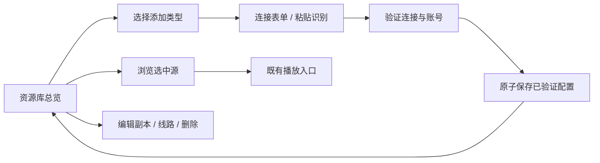

# 资源库整体重构 · 研究后方案

2026-11-09。当前阶段：L1基础层已真机验证，L2总览与连接流程已接入，平板有界验收通过，未全过闸。参考 [六款播放器研究](../../../reference/player-libraries/README.md)；证据见 [空表单和分组](../../../evidence/p240/library-research/status.md)。目标是 Kivo 自己的内容源管理，采用可用的信息结构，不照搬某一款整体皮肤。

## 旧方案裁决

| 现有部分 | 裁决 | 原因/边界 |
| --- | --- | --- |
| `ui/design/Pages.kt` 的 SourcesPage | 重写为内容源总览 | 现在只有四个协议/功能入口，没有已添加源管理；技术实现文案不适合常用页面 |
| `emby/ui/EmbyConnectionScreen.kt` | 重写接入流程 | 缺名称、粘贴识别、持久记录和编辑事务；补字段不能解决流程问题 |
| `EmbySessionModel` | 拆职责 | 保留取消/generation思路、图片缓存上限与错误分类；把源记录/导航从会话中移出。内存令牌可用，但不能替代账号持久化 |
| `EmbyClient` | 复用协议代码并补验证 | login、HTTP状态、电影解析可复用；补服务身份、媒体库目录、剧集、服务端分页。当前不是完整Emby客户端 |
| 分页 WIP | 暂停，审阅后归并 | 已构建但未真机验；不能绕过源管理先交付。分页不是资源库重构的替代品 |
| `EmbyLibraryScreen` | 保留有用海报网格，接新内容范围 | 电影前60条/本地搜索旧口径需废止；需内容库、电影/剧集、分页、搜索的清晰状态 |
| `smb/SmbActivity` | 重写宿主与表单；协议层复用 | 表单/线程/连接/文件列表/下载挤在一个Activity；先保留既有原生SMB桥，不以UI卡改JNI |
| `library/LocalVideoSource`、MediaStore扫描 | 复用 | 本地媒体是内容提供方，不是通用服务器存储；现有`library/`继续承载本地媒体，避免同名职责混用 |
| 播放Intent与硬解链 | 保留入口契约，单独回归 | 认证信息不进日志或证据；音频、Range、退出释放尚需实测，不由界面截图替代 |
| `emby-server-profiles.md` | 降为历史候选，本文件替代其架构 | Emby独占服务器列表会再次割裂SMB与本地；加密、原子保存、显式粘贴原则保留 |

## 信息模型与页面

资源库首页主要展示已添加源。顶部标题、添加和管理入口；本地内容是一个稳定入口，网络源按媒体服务器/文件存储分组。卡片展示名称、协议、简化地址/账号标签与真实状态；未请求的电影数量显示未获取，不能用0冒充。离线源仍可见且可编辑、重试。手机单列/双列由可用宽度决定，平板增加列数，不把表单横向拉满。

概念关系：一个已添加源 = 展示信息 + 协议类型 + 服务器范围内的账号 + 一组线路 + 可用内容视图。首期账号和线路作为源内的值对象，不提前建全局账号中心；不同服务器上的同名账号不共用令牌。同一服务器不同账号可独立存在；同源的备用线路不滥增为独立资源库。



首期先让 Emby 从总览到新增/命名/保存/重启/切换/编辑/删除完整闭环，再把 SMB 接入同一管理层。未实现的 Plex/WebDAV 等不摆可点击假入口。Jellyfin 必须单独验证后才共用协议选项，不能在 Emby 按钮上并列名字冒充已支持。

连接表单首屏：显式“粘贴识别”、名称、完整连接地址、账号、密码和连接保存按钮。名称可空，成功后使用服务器返回名，缺失再用主机名；账号密码不擅自trim密码，空密码合法。端口/服务路径由完整URL解析并在展开项核对，不维持两套互相矛盾的地址状态。线路、备注等渐进展开；不照搬REX五tab与iCloud产品功能。

粘贴只在用户操作时读取；支持带标签分享文本、完整URL与无scheme域名。自动识别只改识别到的字段，不自动连接；多个候选地址或冲突端口要求用户选，不盲猜。密码特殊字符必须原样保留，URL userinfo解出后从展示地址去除。解析器不访问网络。具体语法来自Kivo测试，不声称复制REX算法。

视觉基线：沿用已认可首页的浅色材质、圆角与文字色；绿色仅作协议标识或已证实连接状态，不满屏铺绿。卡片名称允许两行，溢出省略并在管理页显示完整值；尾箭头留独立空间。错误靠近当前操作，连接中阻止重复提交但允许取消；键盘不遮住必填项和提交操作。转场方向/淡入与现有应用一致，跟随系统减少动态效果；具体时长由Kivo连续录屏验收，不照抄未验证CSV常量。

## 保存、会话与失败

源配置包含 schema版本、稳定ID、名称、协议配置、线路及排序。密文保存在noBackupFilesDir，Keystore AES/GCM，随机IV、认证校验、AtomicFile落盘；不做明文SharedPreferences保存、不备份凭据、不打印token。读取损坏/密钥失效显示可见原因，保留旧文件，不静默清空为“没有服务器”。

新增：连接/认证成功后保存；保存失败展示“连接成功但未保存”，不返回成功卡片。编辑：修改副本→验证→原子替换；失败旧配置仍有效。取消/返回丢弃未保存副本，不删除源。删除确认点名源，移除本机记录并取消其在途请求，不删除远端媒体。

令牌按源和线路作用域使用；401才允许针对当前源以保存凭据重新认证一次；403、超时和DNS失败保留配置并分别提示，不循环重登。新线路先核对服务身份，不能把凭据发给未确认的新主机。切换源递增generation，旧搜索/图片/分页响应不得写回当前源；缓存键带源ID、媒体ID和图像tag。会话不把密码、token放入Compose可展示错误或data class默认toString。

服务端返回的ServerId可辅助同服务器识别；未取得前按协议+规范化主地址+用户名做重复预检，成功后再次检查。默认端口归一化、保留路径大小写和反向代理前缀；不以相同主机名强行合并不同路径服务。线路故障切换及自动同步是后续独立任务，首期不做隐式切换。

## 自然家族树与实施边界

根为 `android/app/src/main/java/com/kivo/cinema/`。这是预定归属，仅实现需要的文件，不先创建空目录。

```text
sources/                         已添加源管理；不占用既有本地library语义
  SourceRecord.kt                展示信息与协议配置值对象；秘密不默认toString
  SourceRepository.kt            列表、去重与编辑事务
  SourceShareParser.kt           纯文本识别结果/歧义，不访问网络
  SourceManagerModel.kt          总览/编辑草稿/操作状态协调
  storage/
    SourceStore.kt               版本化序列化与AtomicFile读写
    SourceCipher.kt              加解密与认证
    SourceKeyProvider.kt         Android Keystore密钥生命周期
  ui/
    SourcesScreen.kt             已有源总览与空态
    SourceCard.kt                卡片状态/操作入口
    AddSourceSheet.kt            已接通协议选择
    EmbySourceForm.kt            连接、命名、识别预览、展开项
    SourceManagementSheet.kt     编辑/删除入口与确认
emby/
  EmbyClient.kt                  同步HTTP/JSON协议，调用方管理线程
  EmbySessionModel.kt            认证会话/取消/图片；不存总览记录
  library/EmbyLibraryModel.kt    内容范围、搜索排序、分页与过期响应
  ui/EmbyLibraryScreen.kt        当前源内容浏览
smb/                            原生协议桥保留；表单和浏览职责再拆分
library/                        现有本地媒体扫描/本地浏览
```

依赖：总览→repository→store/cipher/key；总览点击→协议会话→协议客户端→既有播放入口。EmbyClient不读剪贴板、不写源记录；UI不持有磁盘格式；后端核心不依赖sources。

文档归属：研究`docs/reference/player-libraries/`；设计`docs/design/ui/library-rebuild/`；真机证据`docs/evidence/p240/library-research/`与后续`source-management/`。不用根目录新增零散规划文件。

## 顺序与闸门

### L1 实施细化（2026-11-09）

接手环境自检已在用户指定平板完成：本地测试视频出画、独立decode证据、桌面五组核心测试clean-first重建通过。K40离线，本轮仅验证Android源管理，不替代后端性能矩阵。分页WIP已随自检包覆盖安装，仍未验收。

L1先实现Emby配置，后续SMB按协议扩展，UI尚不接入。SourceRecord保存稳定ID、修订号、名称、地址及源内账号；SourceAddress独立承担URL规范化（保留路径大小写，拒绝query/fragment，userinfo仅由分享解析器拆出）。Repository事务在写前重读；编辑必须匹配修订号，拒绝过期草稿。调用方在连接验证成功后才可调用saveVerified，L2负责真实认证闸门。L1不持久令牌，不做隐式线路切换。

补充家族树：`sources/SourceAddress.kt`负责地址语义；`src/androidTest/java/com/kivo/cinema/sources/SourceStorageInstrumentation.kt`负责隔离目录与临时Keystore别名的真机测试。分享识别保留密码冒号后的全部字符；多个地址或冲突字段只返回候选与问题，不自行选定。密钥读取与创建分开，解密时缺密钥不得新建；密文含格式头与GCM认证，未知版本拒绝且保留文件。固定安全错误不包含底层异常文本。

测试覆盖：带标签/URL userinfo/空密码/特殊字符/多地址歧义；加密重建读取、随机IV、认证失败、密钥失效、未知schema、并发写入、重复源、过期编辑、写入失败保留原文件。所有账号均为合成数据，不触碰用户源或正式密钥。

### L2 接入细化

SourceManagerModel负责IO调度、草稿和认证→保存两阶段。验证阶段可取消；提交磁盘事务期间暂不关闭表单，避免取消后实际已保存的歧义。认证失败或保存失败保留草稿；读取损坏时禁新增以保护原文件。SourcesScreen取代SourcesPage旧协议菜单，卡片仅标已保存，不伪装实时在线，不设置数量硬上限。EmbySourceForm限宽、随键盘滚动；粘贴先展示脱敏预览与冲突，再显式填入。SourceManagementSheet含编辑和点名删除确认。源ID是传给EmbyActivity的唯一新增Intent参数，密码不进Intent；会话从加密存储读取后登录。旧无ID入口暂保留兼容，完成新入口验收后再清理。

| 步骤 | 工作 | 进入下一步的条件 |
| --- | --- | --- |
| L0 研究 | 本轮空表单/分组、REX键值、源码复用裁决 | 已归档有界结论；解析/管理/持久行为缺口继续补，不冒充全部了解 |
| L1 源存储与识别 | 加密保存、草稿、名称、重复判断、分享文本解析 | 合成凭据覆盖特殊字符/空密码/多地址；加密重建读取、损坏可见、编辑失败不覆盖；补完CURRENT自检再动代码 |
| L2 总览与Emby闭环 | 多源卡、添加/切换/编辑/删除、跨进程登录恢复 | 至少两源平板与手机尺寸真机闭环，离线卡保留；敏感内容脱敏归档 |
| L3 内容浏览 | 服务器内容库、电影/剧集、服务端搜索/排序/分页 | >60条、取消/快速切换不串源、空与错误区分、重试不重复 |
| L4 SMB归并 | 匿名和账号源保存、共享选择、目录浏览 | 用户指定SMB真实连接与点播；不破坏现有协议桥 |
| L5 体验与播放回归 | 字号/键盘/小屏/平板/动态效果、音频及退出 | 连续录屏与状态矩阵，网络播放真实音频/硬解证据另过闸，不由UI验收代替 |

旧后端P15-B指针保持独立；本卡不修改JNI/Surface/解码生命周期。L1基础层证据见docs/evidence/p240/source-management/status.md；L2–L5未完成，不能声称资源库已重构完成。


### L2 平板阶段记录与下一卡

已验证范围和未测矩阵见 [L2验收](../../../evidence/p240/source-management/l2-status.md)。L2仍DOING，先完成当前未测项；媒体内容混排、服务器库作用域和剧季集缺口已单列 [L3待实施卡](l3-content-scope.md)，本轮不扩大实现。分页WIP作为现有会话依赖保留，不因此标L3完成。
