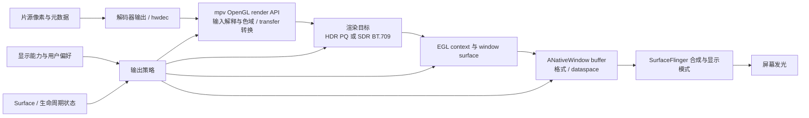

# 274 · HDR 播放与显示链路设计书

状态：**设计基线**（本文件只定义产品行为、架构边界、自然家族树与验收闸门；不包含实现）
上游：[274-design-system.md](274-design-system.md)（视觉体系已归档，本卡不重做 UI）
相关：[273-emby-stutter-fix.md](../../playback/273-emby-stutter-fix.md) §十九（播放链路现状）
历史色彩证据：[P12-E1](../../../evidence/p12e/p12e1-10bit-r1.json)、[P12-E2](../../../evidence/p12e/p12e2-hdr10-r1.json)、[P12-E3](../../../evidence/p12e3/p12e3-hdr10-r1-layer.json)、[P12-E4](../../../evidence/p12e4/p12e4-a-hdr-marked-decode.json)（MediaCodec 输出路径，不等同于 libmpv EGL 路径）

> **设计结论**：先把 HDR 定义为一条端到端、可证明的颜色交付链，再逐段开放能力。只有当片源解释、渲染目标、EGL 窗口、Android buffer 和系统合成器彼此一致时，产品才把本次播放标为 HDR 输出。设备支持 HDR、mpv 含有相关选项、API 调用返回成功，都不能单独证明画面已经正确。

---

## 一、目标与边界

### 1.1 用户结果

1. HDR10 片源在支持且经过验证的显示路径上，保留 HDR 亮度层次与广色域信息；不把 PQ 像素误交给 SDR 图层解释。
2. HDR 片源遇到不支持的设备、渲染路径或 Surface 时，优先使用**已验证的 HDR→SDR 色调映射**继续播放，并明确说明实际输出状态与原因。
3. SDR 片源保持既有 SDR 观感，不因为设备支持 HDR 而被无故提升亮度、改成 PQ 或扩大色域。
4. 播放、暂停、seek、Surface 重建、前后台切换期间，输出模式的切换有确定边界；任何失败都不能留下“界面说 HDR、系统按 SDR 显示”的半配置状态。
5. 用户能理解“自动”和“SDR 输出”的区别；产品不提供无法兑现的“强制 HDR”承诺。

### 1.2 本卡范围

- 定义输入格式识别、输出目标选择、HDR 直出与 SDR 映射的关系。
- 定义显示能力、EGL、buffer 格式、dataspace 与 SurfaceFlinger 证据的分工。
- 定义用户偏好、状态反馈、失败原因、性能边界、自然家族树和实施验收顺序。

### 1.3 不在本卡范围

- 不改播放页、设置页既有视觉体系；新增偏好只复用现有设置行与状态承载位置。
- 不换掉现有 `vo=libmpv` + OpenGL render API，不将切换 `vo_gpu_next` 当成参数实验。
- 不重做 MediaCodec 零拷贝、HDR 解码器能力矩阵或 HDR 素材详情页标记。
- 不承诺 Dolby Vision、HDR10+ 动态元数据或任意设备上的绝对亮度准确性。
- 本文件不指定 tone-mapping 曲线、峰值亮度或最终 mpv 参数数值；这些值必须由目标路径的标准素材和真机结果决定。

---

## 二、现状、已知事实与待证事项

当前主播放路径是：**`vo=libmpv` → mpv OpenGL render API → 应用自管 EGL 窗口 → Android 合成器 → 屏幕**。硬解配置为 `hwdec=mediacodec`，既有零拷贝路径是重要回归基线。HDR 设计必须留在这条路径内，不能把另一种 VO 的能力推定到当前路径。

| 事项 | 当前已知 | 设计含义 |
|---|---|---|
| mpv 输出结构 | Android 以 `vo=libmpv` 调用 `mpv_render_context_create`，API 类型为 OpenGL，逐帧通过 render API 绘制 | 保留 render API；精确渲染路径的 HDR 能力是首要闸门 |
| EGL 窗口配置 | 当前 EGL 初始化请求 RGBA8888、ES2 window config；没有设置 BT.2020/PQ 输出色彩空间 | 现状是 8-bit SDR 窗口路径。先读回运行时 EGL/GL 实际值，不能只看配置代码 |
| 源码注释冲突 | 个别注释把当前上下文称为 GLES3，实际窗口初始化传入 ES2 | 设计依据以运行时 `GL_VERSION`、实际 EGL config 和真实调用为准；实现卡先消除这处事实歧义 |
| Android Surface | 现有证据记录应用图层 `dataspace=UNKNOWN`，HDR metadata types 为 0 | 现状不能作为 HDR 输出；需同时验证 buffer dataspace 与系统图层状态 |
| 设备能力 | K40 报告支持 HDR10、HDR10+、HLG、Dolby Vision；不同系统接口/转储中的亮度字段并不等价 | 能力报告只用于候选路径。`Display.HdrCapabilities` 的亮度是系统报告的内容目标，不是经过色度计校准的面板峰值 |
| 库与选项 | 项目使用 libmpv 0.39 系列；二进制中存在 libplacebo 符号及 `target-*`、`tone-mapping` 字符串 | 这只能证明代码/选项存在，不能证明当前 render API、驱动与 Surface 组合正确工作 |
| P12-E 证据 | E2/E3 在 MediaCodec 直出路径上验证过 HDR10 dataspace 与系统图层；E4 证明该路径没有实现 tone mapping | 这些证据不能替代当前 libmpv + EGL 路径的端到端证据 |

源码锚点：[mpv_options.cpp](../../../../android/app/src/main/cpp/mpv/mpv_options.cpp)、[mpv_egl_surface.cpp](../../../../android/app/src/main/cpp/mpv/mpv_egl_surface.cpp)、[mpv_gl_render.cpp](../../../../android/app/src/main/cpp/mpv/mpv_gl_render.cpp)、[P12-E3 图层证据](../../../evidence/p12e3/p12e3-hdr10-r1-layer.json)、[P12-E4 tone mapping 结论](../../../evidence/p12e4/p12e4-a-hdr-marked-decode.json)。

### 2.1 必须守住的事实边界

- mpv OpenGL render API 与 `vo_gpu_next` 是不同的输出架构。不能因 mpv 支持某个 VO，推断当前 API 也具有相同的颜色转换、元数据下发或 HDR 目标选择行为。
- 仓库中存在 libplacebo 或 mpv 选项字符串，不等于当前 Android 二进制的选项被接受，更不等于 render API 实际采用了它们。
- `Display.HdrCapabilities`、`isHdr`、EGL 扩展和厂商属性分别回答不同问题；它们均不能替代正在播放的图层和图像验证。
- `hdr metadata types` 非零只说明类型位出现；不能证明 metadata 数值正确。`HDR Panel:true` 是设备能力字段，不是当前播放状态。
- SurfaceFlinger dataspace 的枚举名或数值也不能反推 GL shader 已经按相同色彩空间编码。
- 现有 `MediaCodec → Surface` 的成功路径，不证明 `MediaCodec → mpv/OpenGL → Surface` 路径同样成功。

---

## 三、颜色模型与端到端链路

每一帧都要有明确的**输入描述**、**渲染目标**与**输出信号**。三者必须分开建模，不能用一个“HDR 开关”代替。



### 3.1 分层契约

| 层 | 必须记录的事实 | 不能据此单独宣称 |
|---|---|---|
| 输入 | primaries、transfer、matrix、bit depth、静态/动态 metadata、metadata 是否缺失或冲突 | “HDR 解码完成”不能证明 HDR 显示完成 |
| 解码 | 实际解码器、输出格式与位深、硬解/软解状态、色彩信息是否保留 | `hwdec=mediacodec` 本身不证明输出像素仍保有目标位深或 metadata |
| 渲染器 | 当前 render API、实际接受的选项、源到目标转换、tone mapping 是否执行 | 库里包含某渲染器或某个 option 字符串不能证明此层生效 |
| EGL | 实际 config 通道位数、GL context 版本、surface 创建色彩空间、扩展与调用返回值 | 申请 10-bit config 不代表 EGL 最终给出该 config |
| Android buffer | 实际 buffer 格式、buffer dataspace、API 支持情况、配置结果 | 设定 dataspace 不代表像素已经按该 dataspace 编码 |
| 系统显示 | 对应播放器 layer 的 dataspace、HDR 动态范围与可见 metadata 状态 | 显示器“支持 HDR”或单独一项 metadata 不证明画面正确 |
| 面板 | 可测亮度、灰阶、色域与色差 | 系统报告值不能替代仪器测量 |

### 3.2 三种独立输出属性

1. **存储格式与精度**：例如 RGBA8888、RGBA1010102 或经验证的浮点格式。像素格式描述分量布局和精度，不描述 transfer function。
2. **渲染颜色空间**：mpv/OpenGL 如何把输入转换并编码到目标 buffer，包括 primaries、transfer 和 tone mapping。
3. **系统 dataspace/显示信号**：告诉 Android 合成器 buffer 像素所代表的颜色及动态范围。

只有三项彼此一致才构成输出 profile。RGBA1010102 是每像素 10/10/10/2 位，**与 RGBA8888 一样都是 4 字节/像素**；不能据此宣称 framebuffer 带宽或显存必增 25%。实际成本要以设备分配、GPU pass 和内存采样测量。

Android NDK 的 `ANativeWindow_setBuffersDataSpace()` 只影响调用之后入队的 buffer，且从 API 28 起可用；RGBA_1010102 从 API 26 起可用。这两个版本门槛不同，必须分别判断。Surface/EGL 色彩空间也不能通过虚构的 Java `Surface.setColorSpace()` 替代。

---

## 四、输入格式支持策略

本设计按能力分期承诺。仅当当前播放器链路读取到可信 metadata，且目标路径完成对应素材验证，才把该类型计为支持。

| 输入类型 | 初始产品承诺 | 输出规则 | 不满足时 |
|---|---|---|---|
| SDR BT.709 | 完整支持 | 保持 SDR 目标和原有 SDR 参考白，不因设备 HDR 能力改成 PQ | 保留现有 SDR 行为并记录实际 profile |
| HDR10 / BT.2020 PQ | **首期目标** | 满足全部 HDR 输出闸门时输出 BT.2020/PQ；否则走已验证的 HDR→SDR tone mapping | mapping 未验证或失败时显示原因，不能伪称 HDR 或无痕直通 |
| HLG | 后续能力 | 仅在 HLG 输入解释、显示 signaling 与灰阶/高光映射均单独验收后开放 | 使用已证实可用的映射；否则标为未支持/未知 |
| HDR10+ | 后续能力 | 动态 metadata 能从容器/解码路径到达渲染器且每场景映射可验证后才承诺动态映射 | 只有当前文件或解码器明确提供有效 HDR10 基础信息，且 HDR10 静态映射已在当前路径验证时，才允许标为静态回退；否则标为未知/不支持，不得宣称 HDR10+ 动态映射 |
| Dolby Vision | 暂不承诺 | 仅支持已明确验证的 profile、layer 与 fallback 路径 | 不得根据设备声明或解码成功推断输出正确；无法确认时显示“格式未验证” |
| 缺失、矛盾或未知 metadata | 明确为未知 | 不主动标 HDR；只采用对当前格式有证据的安全路径 | 记录非空原因；不根据文件名、徽标或单个 codec 字段猜测 |

### 4.1 色调映射语义

- HDR→SDR 是**渲染器内的像素变换**，不是把 decoder 的 transfer 请求当作已生效，也不是简单改 dataspace。
- 映射需要联合处理亮度压缩、色域压缩、黑位与 OSD/字幕合成顺序；最终参数要对比标准测试图与真实片源后定。
- PQ 源和 HLG 源必须分别验证。HDR10 tone mapping 的证据不能外推到 HLG、HDR10+ 或 Dolby Vision。
- 若 mpv 当前 render API 对 tone mapping 的支持无法确认，结果状态是“未验证”，不得把“选项被接受”记录为“映射已生效”。

---

## 五、产品偏好与决策规则

### 5.1 用户可选项

提供两个清楚、可兑现的选择，沿用现有设置视觉组件与文案风格：

| 选择 | 默认 | 对用户的承诺 |
|---|---:|---|
| **自动** | 是 | SDR 保持 SDR；已验证的 HDR 源在整条 HDR 路径可用时输出 HDR；否则使用已验证的 SDR 映射，并告诉用户原因 |
| **始终使用 SDR** | 否 | 所有已识别 HDR 源都请求 renderer 映射到 SDR；若当前路径不能证明映射有效，明确提示不支持，不谎称“兼容输出” |

不提供“强制 HDR”：应用不能把不支持 HDR 的显示设备变成 HDR 显示，也不能用切换 dataspace 创造 HDR 信息。未来若产品确实需要高级偏好，应以实测能力重新定义语义，不能让“强制”掩盖回退。

设置副标题显示当前播放的**实际决策结果**，用用户语言说明“HDR 输出”“SDR 映射”或“状态未知”，不展示内部 L0/L1/L2 档位。设备不支持时选项仍可读；说明写出原因，不做无解释的灰显。

### 5.2 决策输入与输出

决策器是纯规则层，输入为：

- 用户偏好；
- 输入 profile 与 metadata 可信度；
- 当前显示器/显示模式报告的 HDR 类型与亮度目标；
- 当前 mpv render API、已验证渲染能力；
- EGL config、window surface、Android buffer format/dataspace 可用性；
- Surface generation 与生命周期状态。

输出为一个完整且不可拆分的 profile：

| 字段语义 | 允许值示例 | 约束 |
|---|---|---|
| 请求模式 | automatic / sdr_only | 用户偏好本身 |
| 源类型 | sdr / hdr10_pq / hlg / hdr10plus / dolby_vision / unknown | 来源须能回溯到 metadata 或 decoder readback |
| 目标模式 | hdr_bt2020_pq / sdr_bt709 / unresolved | 不得只设置其中一层 |
| 转换 | identity / hdr_to_sdr / unsupported / unknown | 只有已验证路径才能记为 identity 或 hdr_to_sdr |
| 结果 | configured / active / fallback / pending / failed / unknown | `configured` 表示本次配置调用成功；`active` 还要求该设备/API/驱动组合已验证。未知组合或缺少运行时证据时显示“状态未确认”并附原因，不发布 `active` |
| 原因 | 稳定的非空 reason code + 可读说明 | 任何 fallback/failed/unknown 都必须有原因 |

目标峰值亮度以显示 API 报告值、来源 metadata、设备 profile 和仪器校准置信度分层处理。Android 的 desired luminance 可作为策略输入之一；它既不是面板校准峰值，也不能直接复制成 `target-peak`。无校准数据时，使用经过目标设备实测的保守 profile；缺少实测就记录未知并限制承诺。

---

## 六、Surface 与 EGL 输出契约

### 6.1 HDR 输出就绪条件

HDR profile 只有同时满足以下条件，才允许进入播放态：

1. 源格式已可靠识别为本阶段承诺支持的 HDR 类型，且有效像素可由当前解码路径提供。
2. **当前 `vo=libmpv` OpenGL render API** 在目标 Android ABI、mpv/libplacebo 版本和驱动上，已用标准素材证明会执行所请求的目标色彩转换。
3. EGL 扩展、config 与窗口 surface 能创建为经过验证的 PQ/BT.2020 输出；实际 GL 渲染目标精度符合 profile。
4. `ANativeWindow` 后续 buffer 使用匹配的像素格式和 dataspace；每项配置均有返回结果或可靠读回。
5. 播放器图层在 SurfaceFlinger 观察到符合预期的 dataspace/dynamic range；测试必须指定带 `#id` 的 layer 名称。
6. 灰阶、高光、广色域与色调映射测试图通过视觉/测量验收，性能和生命周期回归通过。

任一条件不成立，HDR 输出 profile 不得标为 `active`。

### 6.2 建立和切换

- EGL colorspace 属于 EGL surface 的创建配置。profile 切换需要按目标平台能力创建/切换合适的 EGL window surface，不能假定已有 surface 可以原位改色彩空间。
- buffer dataspace 对调用之后入队的 buffer 生效；切换时必须设定新 dataspace 后再提交第一帧新 profile。
- 颜色配置按事务提交：准备候选 profile → 验证 EGL/buffer 配置 → 首帧按新目标渲染 → 观察到可确认的成功结果 → 发布新状态。失败时保持原有效 profile，或切换到经过验证的 SDR 映射并发布明确原因。
- 不允许同一帧处于“PQ 编码像素 + SDR dataspace”或“SDR 编码像素 + PQ dataspace”的可见状态。切换期间宁可短暂保留上一帧/显示过渡，也不要提交含义矛盾的 buffer。
- 如要改变 EGL config，先单独证明能保留 OpenGL context 和 mpv render context。未经验证不得销毁并重建整个 mpv render context；现有代码已有重建黑屏风险。
- Surface 生命周期遵守 P12-D1：Surface 暂时离开时采用应用侧状态与丢帧决策，不依赖 `setOutputSurface(nullptr)`；旧 `ANativeWindow*` 在不再被 EGL 使用前不得释放。
- Surface 重建、窗口尺寸/显示模式改变、前后台切换后使能力快照失效，重新计算并在新 Surface generation 上完整提交 profile。

### 6.3 颜色与亮度目标

- `target-prim`、`target-trc`、`target-colorspace`、`target-peak`、`tone-mapping` 等值属于 renderer 目标描述；它们必须与 EGL 和 buffer 的实际输出含义一致。
- 不将面板报告的 420 nit、媒体 mastering peak、MaxCLL 或用户屏幕亮度互相替代。
- 参数由设备 profile + 输入 metadata + 输出模式确定；统一默认值只能作为经验证的策略，不能成为未经测量的全局真值。
- mpv option 每次设定必须检查返回码；被拒绝、被覆盖或运行时无效都要留下日志和 reason。静态二进制扫描不算能力验证。

---

## 七、字幕、OSD 与播放器 UI 的色彩契约

视觉体系冻结为现有设计。这里定义颜色行为，不增加 UI 风格或新一套控件。

| 内容 | 设计规则 |
|---|---|
| 视频字幕与 mpv OSD | 明确在 HDR/SDR 转换链中的合成位置。默认按 SDR UI 参考白设计并映射到当前目标，避免白字幕随着 HDR 峰值变成刺眼高亮 |
| Compose 播放控制层 | 继续由 Android UI 层绘制，沿用现有颜色与组件；不把控件颜色混入视频的 PQ metadata，也不因 HDR 改现有主题色 |
| 状态反馈 | 复用现有状态承载位置。只在真实发生回退/失败时给出短说明，文案优先说“当前使用 SDR 映射”和原因，不出现无解释的 L0/L3 |
| 字幕亮度与描边 | 不在本卡引入新的逐项偏好。用参考 HDR 片段测字幕白、边缘和半透明叠加，确认不裁白、不染色、不遮挡高光细节 |

验收要覆盖内嵌字幕、外挂字幕、ASS/SSA、OSD 与控制层同时出现的场景。单独看干净视频画面通过，不代表字幕/OSD 色彩正确。

---

## 八、性能、稳定性与降级

### 8.1 性能目标

- 使用同设备、同片源、同版本、相同显示亮度与相近热状态做配对基线。
- 目标帧率保持媒体原始帧率；不新增丢帧、重复卡顿或 `Enter buffering`。现有 23.96 fps 结果作为该片源的参考值，不转写为适用于所有帧率的硬编码门槛。
- 验证至少包含 1080p HDR10、4K HDR10、SDR 对照，以及一次持续播放/seek/暂停恢复/前后台往返。
- 记录 GPU/RenderThread 时长、帧间隔分布、缓冲事件、EGL mtrack、Graphics、Native Heap、PSS 与热状态。绝对显存增量预算待基线采集后制定，不预先承诺固定 +20 MB。
- RGBA1010102 与 RGBA8888 都是 4 B/像素；GPU 实际带宽、压缩、额外 render pass 和分配行为需要单独测量。

### 8.2 回退规则

回退由**配置或能力失败**触发，不由任意掉帧阈值暗中自动触发。

1. HDR 输出 profile 配置失败，且 SDR mapping 已在当前路径验证：切换为 SDR mapping，记非空原因，并通过既有状态入口向用户说明。
2. SDR mapping 未验证或不可用：不得把普通渲染伪装成已 tone-map。将结果标为 failed/unknown，展示原因，并按播放器既有错误策略处理。
3. 性能变差：记录诊断并保留用户可见状态；允许用户主动切换到 SDR。不能在播放中悄悄来回切换，造成亮度闪变或用户偏好失真。
4. Surface 或显示模式变化：profile 暂时为 pending；完整重算后再发布新状态。旧能力快照不能跨 Surface generation 继续使用。

---

## 九、自然家族树与职责边界

实现进入下一阶段前，先冻结以下职责与目录；只有真实职责存在时才落文件。实际文件名可由实现卡按仓库现有族谱微调，但不得把探测、决策、EGL 生命周期和 mpv 参数塞成一个大模块。

```text
android/app/src/main/java/com/kivo/cinema/
├─ mpv/color/
│  ├─ DisplayColorCapabilities.kt   只采集当前 display/mode 的系统报告
│  ├─ PlaybackColorProfile.kt       表达输入、目标、转换、状态和原因
│  └─ PlaybackColorPolicy.kt        纯决策：偏好 × 输入 × 能力 → 候选 profile
├─ playback/
│  └─ MpvStartSequence.kt           接收已冻结 profile；不自行猜测颜色能力
└─ ui/design/settings/
   └─ SettingsAppearanceSub.kt      只把两态偏好接入既有设置行和现有视觉体系

android/app/src/main/cpp/mpv/
├─ color/
│  ├─ mpv_color_profile.hpp/.cpp    把已选 profile 翻译为经过核验的 mpv 目标并检查回执
│  └─ egl_color_output.hpp/.cpp     只负责 EGL/window 输出 profile 的创建、确认与释放
├─ mpv_session.cpp                  串联既有 session 生命周期，不复制决策规则
├─ mpv_gl_render.cpp                使用当前 render context，不因 HDR 引入第二套 VO
└─ mpv_options.cpp                  保持基础选项职责；不要平铺 HDR 条件分支
```

职责原则：

- Kotlin 侧能力采集与策略决策分开；策略层可用纯数据测试，不依赖 Surface 或 Android UI。
- C++ 侧 mpv 目标映射与 EGL 窗口输出分开；每一个外部 API 配置都返回明确结果与原因。
- 单一 profile 是 Kotlin → JNI → C++ 之间的语义契约；避免两边各自推断“现在是不是 HDR”。
- 日志和证据应表达请求值、接受结果、实际选定 profile 与回退原因；不重复堆叠多个同义状态字段。
- UI 只展示策略层/内核回传的事实，读不到时展示“未知”，不从片源扩展名或设备型号推断。

---

## 十、实施闸门与验收顺序

每道闸门都需要通过证据后才进入下一道。某项失败时保留“未验证/不支持”的精确结论，不用源码推断补齐。

| 闸门 | 要回答的问题 | 通过条件 |
|---|---|---|
| G0 · 基线与素材 | 有没有适合复算的 SDR/HDR10/HLG/HDR10+ 标准素材？当前渲染器、EGL、显示模式和设备热状态如何？ | 固定文件 hash、容器/transfer/primaries/bit depth/metadata；保存当前渲染器和 SurfaceFlinger 基线；确认实际 GL/EGL 值 |
| G1 · 当前 render API 能力 | 当前精确的 `libmpv` OpenGL render API 能否正确处理 HDR 输入并输出已知 SDR 参考？ | 选项被接受且生效；HDR→SDR 测试图灰阶、高光、色相/饱和度无明显裁切；结果可从输入和输出证据复算 |
| G2 · HDR10 端到端输出 | 当前路径能否输出 BT.2020/PQ 且被 Android 合成器识别？ | EGL config/surface、buffer format/dataspace 和指定 `#id` 的系统 layer 状态相符；真实 HDR10 pattern/片源通过；不能以“接口成功”代替 |
| G3 · 偏好与失败路径 | 自动、SDR 输出、缺能力、API 拒绝、metadata 未知、Surface 重建时表现是否可理解？ | 每类输入/错误都有确定 profile、稳定非空 reason；回退通知准确；不存在混合 dataspace 的首帧 |
| G4 · 播放回归 | 长播、seek、暂停恢复、前后台和字幕叠层是否稳定？ | 目标片源保持原帧率；没有新增掉帧/缓冲/黑屏；Surface 生命周期遵循 P12-D1；热状态与内存数据留证 |
| G5 · 兼容范围 | 非 HDR 屏、旧 Android API、其他 SoC/GPU 的实际行为是什么？ | 能力不足时准确回退或报错；不声称未覆盖机型已支持；形成设备/API/输出 profile 矩阵 |

### 10.0 G0 / G1 的执行结果（2026-11-14，K40 `b6e950ee`）

> 本节是**闸门执行记录**，不是新结论 —— 结论都在上面的正文里。
> 证据目录：`docs/evidence/p274-hdr/`（`g1/` · `g1-es3/` · `g1-hdr10/` · `l2/`）。

| 闸门 | 结论 | 关键证据 |
| --- | --- | --- |
| **G0 · 基线与素材** | ✅ **通过** | HDR10 素材可用：`build/avtmp/hdr10_1080p.mp4`（ffprobe 实测 `hevc` / `bt2020nc` / `smpte2084` / `bt2020` / `yuv420p10le`）；设备 `/sdcard/Download/hdr10.mp4`；K40 报告 `mSupportedHdrTypes=[1,2,3,4]`、`GLES 3.2`、EGL 含 `EGL_EXT_gl_colorspace_bt2020_pq` |
| **G1 · 当前 render API 能力** | ❌ **未通过** | 见下 |

**G1 的决定性证据（三条独立）**：

```
[0.012][v][libmpv_render] Disabling HDR peak computation
        (one or more of the following is not supported: compute shaders=0, SSBO=1).
```

1. **选项被接受但不生效**：`target-trc=pq` / `target-prim=bt.2020` /
   `target-peak=400` / `tone-mapping=hable` 四个选项回执**全部 `ok=true`**，
   但同一时刻内核报 HDR 峰值计算被**禁用**。
2. **不是设备能力问题**：同一份日志里 `GL_VERSION='OpenGL ES 3.2'`、
   `Detected GLES 3.2.`、`GL_SHADING_LANGUAGE_VERSION='OpenGL ES GLSL ES 3.20'`、
   `SSBO=1` ⇒ 设备只差 **compute shader**。
3. **是渲染后端的固有限制**：该日志字符串在 `libmpv.so` 里的上下文字符串是
   `../video/out/gpu/video.c` / `../video/out/gpu/osd.c` ⇒ 属 **legacy RA（`vo_gpu`）**；
   而我们用的是 `MPV_RENDER_API_TYPE_OPENGL`（`mpv_gl_render.cpp:148`）⇒ 内部就是 legacy RA。
   **把 EGL context 升到 ES 3 实测仍然禁用**（`g1-es3/`）⇒ 不是 context 版本问题。

⇒ **G1 判决：当前 render API 路径不具备 HDR 输出能力。**
按本文件 §十的规矩（"某项失败时保留'未验证/不支持'的精确结论"），
**G2 不启动**，且**不引入任何 HDR 输出宣称**。

⇒ **后续路径**（按本文件 §1.3「不换掉现有 `vo=libmpv` + OpenGL render API」的范围约束）：
- **R2（✅ 已落地，2026-11-15）**：只做 **L2 = HDR→SDR tone-map**。
  ⇒ 见 [276-hdr-tone-map-l2.md](../../playback/276-hdr-tone-map-l2.md)：
  真机三臂 + 自动路径验证通过（同一段 PQ 画面 mean 75.0 → 93.7，SDR 片源零改动）。
  **仍然不宣称 HDR 输出**（G2 未过，架构闸门依旧）。
  它不需要 PQ 输出，只需要 tone-map 曲线 ⇒ 可能留在现有后端上。
  ⚠️ 但 **legacy RA 的 tonemap 支持有限**，需按 §六/§八单独取证
  （`tone-mapping-visualize` 是现成的可视化判据）。
- **R1（架构级，本卡范围外）**：换 `vo_gpu_next`（内置 libplacebo）⇒ 独立立项。
- **R3**：诚实降级提示 —— **需要改 UI**，与用户「不允许写 UI」的约束冲突，本轮不做。

**踩坑记录**：
1. `adb push` 到 `/data/local/tmp/` 报 `remote fchown failed: Operation not permitted`
   ⇒ 改推 `/sdcard/Download/`（Git Bash 下路径要写 `//sdcard/...`，否则被 POSIX 转换）。
2. Python 的 `http.server` **不支持 Range** ⇒ mpv 代理链路卡在起播（`内核起播超时`）
   ⇒ 改用 `tools/p274_local_origin.mjs`（支持 206）。
3. 本地文件走 `kivo.media` ⇒ 进的是**自研内核**（`playbackSession`），**不产 mpv 日志**
   ⇒ 验证 mpv 路径必须用 HTTP 源（`kivo.playurl`）。

### 10.1 颜色正确性的证据要求

- 至少包含标准灰阶、PQ/HLG 亮度阶梯、BT.2020 饱和色块、亮部 roll-off 细节和黑位阶梯；保存 pattern 版本、hash 与 metadata。
- 保存 mpv 输入识别、实际 option 回执、输出目标、解码路径、EGL config/扩展/调用结果、buffer format/dataspace。
- SurfaceFlinger 查询必须使用**带 `#id` 的实际图层名**，同时记录原始命令、完整输出、时间戳和显示模式。只记录“找不到数据”不足以推出“不支持”。
- HDR 输出需要同时记录图层 dataspace/dynamic range 与真实像素质量。两者缺一不可。
- 截图只可辅助检查构图、明显裁白与 UI；截图、录屏和近白像素比例都不能单独证明 PQ 曲线、色域或绝对亮度准确。
- 如无色度计/亮度计，色差、面板绝对 nits、峰值准确性必须标为**未测**。可报告路径与算法行为，不能宣称达到色准或亮度规格。
- 所有失败样本、回退原因和环境变化一并保存；不因结果“不好看”删掉某轮或调整阈值掩盖回归。

---

## 十一、风险与未决项

| 风险/未知 | 处理方式 |
|---|---|
| 当前 render API 与 libplacebo 的关系未由运行时证据完全确认 | G1 是架构闸门；未通过前不引入 HDR output 宣称 |
| ES2/ES3 代码注释与运行值冲突 | 运行时读回真实 GL/EGL 值；升级 context 仅作为独立实验，不能与 PQ、buffer format 一次叠加改变 |
| 厂商 HDR 能力与亮度字段语义不同 | 原样记录来源/单位/置信度；不把 API 目标亮度当面板校准值 |
| Android API 版本与 PixelFormat/NDK dataspace 能力不同步 | 分别按 API 条件探测，缺少任一项就不选对应 profile |
| SurfaceFlinger layer 枚举与应用提交值可能不同 | 设备上读取实际 layer；不能以请求值代替合成器观察值 |
| 字幕/OSD 可能位于视频 tone mapping 的不同侧 | 单独确定合成顺序并使用带字幕测试素材验收 |
| 动态 HDR 格式的 metadata 可能在解码链丢失 | HDR10+ / Dolby Vision 在专门证据完成前不对用户承诺 |
| HDR 开启后功耗、温升或 GPU 负载变化 | 同条件长播测量；不以固定理论比例推算设备行为 |
| P12-E 和本路径的证据容易混用 | 报告显式写明“MediaCodec 直出”或“libmpv/EGL”，跨路径证据不互相替代 |

---

## 十二、权威参考与项目依据

- [Android NDK · Native Window](https://developer.android.com/ndk/reference/group/a-native-window)：`ANativeWindow_setBuffersDataSpace()` 的 API 版本、调用影响和返回值。
- [Android · Display.HdrCapabilities](https://developer.android.com/reference/android/view/Display.HdrCapabilities)：HDR 类型与 desired luminance 的系统 API 语义。
- [Android · PixelFormat](https://developer.android.com/reference/android/graphics/PixelFormat)：RGBA_1010102 格式与 API 版本。
- [mpv v0.39.0 · render.h](https://github.com/mpv-player/mpv/blob/v0.39.0/include/mpv/render.h)：Render API、OpenGL context 使用约束与软件 renderer 边界。
- [mpv v0.39.0 · render_gl.h](https://github.com/mpv-player/mpv/blob/v0.39.0/include/mpv/render_gl.h)：OpenGL render API 初始化契约。
- [mpv v0.39.0 · options.rst](https://github.com/mpv-player/mpv/blob/v0.39.0/DOCS/man/options.rst)：target、HDR 与 tone mapping 选项的版本化定义。
- [273 · Emby 播放卡顿设计](../../playback/273-emby-stutter-fix.md) §十九：当前播放链路与 G-HDR 缺口。
- [P12-E2](../../../evidence/p12e/p12e2-hdr10-r1.json)、[P12-E3](../../../evidence/p12e3/p12e3-hdr10-r1-layer.json)、[P12-E4](../../../evidence/p12e4/p12e4-a-hdr-marked-decode.json)：MediaCodec 直出路径的 HDR 标记、合成器观察与 tone mapping 结论。

---

## 定稿判据

- [ ] 产品模式只有可兑现的自动 / SDR 输出语义，不存在“强制 HDR”假承诺。
- [ ] 所有 supported/unknown/fallback 状态都有来源、理由和可复算路径。
- [ ] 当前 render API 的验证是 HDR 宣称的前置闸门，MediaCodec 旧证据没有被跨路径套用。
- [ ] EGL、buffer 格式、dataspace、系统 layer 和像素正确性各有独立证据。
- [ ] 家族树职责清晰，符合单文件单职责与不平铺要求。
- [ ] 设计未锁死未经实测的亮度、曲线、性能比例或截图阈值。
