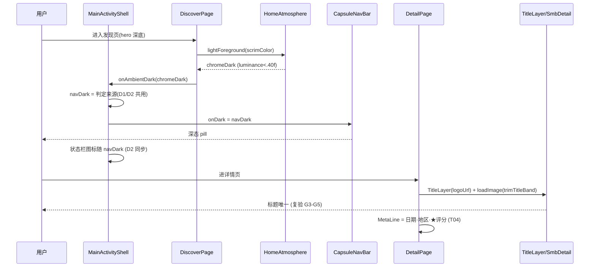

# 第一波 P0 实施级架构设计（任务分解）

> 设计人：架构师 高见远（Gao）｜日期：2026-11-19｜性质：**只出设计 + 任务列表，不改一行业务代码**
> 仓库根：`C:\kivo video`（单仓库、单 applicationId，禁止建副本工程）
> 最高约束：`docs/evidence/design-audit/OVERVIEW.md` 第二节「三条 P0 必须修正」+ 第五节第一波
> 已定稿视觉（只对齐、不自创）：`docs/design/visual-polish-spec.md`、`docs/design/ui/replica/nav-capsule-v3.md`

---

## 铁律合规（用户长期约束 · 逐条对照）

> 以下四条为硬约束，违反即返工。本设计逐条对照并给出落盘位置；工程师照此施工。

| # | 用户铁律 | 本设计如何满足 | 落盘位置 |
|---|---|---|---|
| ① | **同一工作目录** `C:\kivo video`，禁止新建项目包/副本工程/第二个 applicationId，只在此仓库根操作 | 全部路径均以该仓库根为基准；**不新建任何包、不建副本、不动 applicationId**；唯一新增文件 `ui/design/PosterPlaceholder.kt` 落在既有 `com.kivo.cinema.ui.design` 包内 | 本文档所有路径；§2 家族树 |
| ② | **单文件单职责**：一文件只干一件事，禁止职责混杂；任务列表每个文件都要能一句话说清职责 | §2 家族树每个文件都有「职责」列，逐文件一句话说清；§3 每个任务的源文件均可在 §2 查到该一句话职责；本波**不制造新的 god object**（不把占位/令牌/判定硬塞进同一文件） | §2 三张家族树表 |
| ③ | **先规划文件家族树再写代码**：家族树必须先落盘，明确每文件职责与依赖，工程师照树施工 | 本文档即落盘的家族树；§2 位于 §3 任务列表**之前**；逐文件标注职责/预估行数/门禁敏感，§3.1 给出依赖关系图。**工程师不得新增家族树之外的文件，不得边写边加文件** | §2 → §3 → §3.1 |
| ④ | **不准堆砌代码**：禁大段冗余复制、禁把功能硬塞进单文件；新代码落地必须**彻底移除被替代的旧代码**，任务列表凡涉及替换须标注「删除哪个旧文件/旧函数」 | 占位逻辑独立成 `PosterPlaceholder.kt` 而非塞进 `TmdbImage`；评分合并后**删除**独立 `RatingBadges` 块；所有替换点在 **§2.1 旧代码移除清单**逐条标注删除对象，禁止新旧并存 | §2.1 + T01~T04 |

---

## 0. 设计前提与核对口径

### 0.1 本设计不是照单改报告，而是先纠偏

OVERVIEW 已明确：三份分项报告的 P0-01/P0-03/P0-05 **不能照字面改**。本设计逐条回到源码核对（下表），确认「哪些已有防线、哪些是真缺口」，再定工程动作。

### 0.2 源码核对结论表（本轮实际 Read/Grep，非报告转述）

| 报告条目 | 报告说法 | 源码实际（文件:行） | 纠偏判定 |
|---|---|---|---|
| P0-01 标题三重叠加 | 海报美术字+自绘白字+自绘黑字同屏 | `DetailHeroContent.kt:30-48` TitleLayer 已 logo 优先：有 `logoUrl` 且加载成功→只画 TMDB logo，不画自绘 Text；失败/无 logo 才画单套 34sp Text。`SmbDetail.kt:68,129` loadImage 已套 `.trimTitleBand()`，`:269-273` 裁掉底部 15% 烧字带 | **两道防线已存在**；报告证据是修复过程旧图。必须先真机复验，禁止据旧图改码 |
| P0-02 详情背景脏灰 | 没接海报取色 | `DetailPage.kt:103-110` 已 `PosterPalette.ambientOf(bmp)`→`fieldColor`；`DetailBackdrop.kt:53-64` 已用 field 画 verticalGradient。**已接入**，只是 `ambientOf`（`PosterPalette.kt:9-35`）取底部 15% 线性光平均，饱和度偏低可能显灰 | 属"已实现但效果待验"，非"没做"。真机复验后再决定是否调饱和曲线 |
| P0-03 删 SDR 大字/折叠资源卡 | 信息极简 | `DetailResource.kt:89-136` 正是用户上一轮真机确认的 REX 式小豆腐块：18sp SDR 主标题 + 图标化容量码率 + 绿菱形来源 + 绿圆勾；`:84-86` 有固定 `width(210.dp)` + 非 IntrinsicSize 防坑注释。工作日志 `2026-11-19.md:148-152` 记录用户裁决 | **与用户裁决冲突，保留不动**；只做评分并入 meta 行 + 消空白 |
| P0-04 空图裸色块 | 统一占位 | `TmdbImage.kt:81` `TmdbPlaceholder = Color(0xFFE9E4EE)` 是裸色；`:115,130` 失败即纯色 `Box(background(bg))`，无微光/glyph。`NasPosterPlaceholder.kt` 已有渐变+首字占位（好实现，应保留） | **真缺口**，且是唯一需新建组件的批 |
| P0-05 导航深灰底黑字 | 深态没实现 | `CapsuleNavBar.kt:41-92` onDark 深态**完整存在**（`:51-52` pill/idle、`:62` 前景、`:66` 选中底）。唯一判定点 `MainActivityShell.kt:125` `onDark = page == 1 && state.ambientDark` 太窄 | **不是重做组件，是改一个布尔的来源** |
| 额外发现① | 报告称"详情页胶囊" | `CapsuleNavBar(` 全项目**唯一调用点** `MainActivityShell.kt:110`；详情页 `MovieDetailActivity` 是独立 Activity，`DetailPage` 不渲染胶囊 | P0-05 实际作用域是**发现页(page=1) hero 深环境**，非真正详情页。截图归属需拍板（§7） |
| 额外发现② | 报告称深态选中蓝 | `nav-capsule-v3.md §二` 要求暗态选中 = 白14% pill + **navActive 蓝**；`CapsuleNavBar.kt:62` 暗态选中前景实为 `Color.White` | 与定稿 spec 有偏差，但本波只改判定来源、**不引入新视觉**，列待明确（§7） |

### 0.3 铁律（违反即返工）

1. 单文件单职责，Kotlin **≤300 行**；先规划文件家族树（§2）再写代码。
2. **不做 UI 结构大改**：只允许对齐已定稿规范（`visual-polish-spec.md` / `nav-capsule-v3.md`），不自创视觉。
3. 改动必须过 `python tools/ui_gate.py`：**裸色数不得增加、不得新增 >300 行文件**。
4. 历史坑勿回退：`activeId` 必须 `mutableStateOf`；`WatchingSwipeRow.kt:96` 的 `matchParentSize`、`DetailResource.kt:85` 的非 IntrinsicSize 防坑注释保持原样。
5. 紫色系私有色 `DetailActionMenu.kt:27-28,90`（`0xFF655978`/`0xFFF3F0F8`/`0xFFE7E1F0`）收敛进 palette 或改中性，**不新建第四套强调色**（本波不处理，归第二波 P1-09/C9）。
6. 临界文件（`SmbDetail.kt`/`MainActivityShell.kt`/`DiscoverPage.kt` = 300 行，`DetailPage.kt` = 290 行）**任何净增行都会 FAIL**，改动以"等值替换/净减行"为原则。

### 0.4 门禁实测基线（本轮 `python tools/ui_gate.py --json`）

`bare_color_total=316`（baseline 326）｜`files_over_300=19`（均白名单内）｜`page_preview_missing=4`｜`regressions=[]`｜`exit_code=0`。
本波所有改动以 **316 为裸色上限**，目标净下降（占位色归位 palette 可 −1，删演职员裸色可 −1）。

---

## 1. 主理人三条修正的落地解读（逐条工程动作）

### 修正 1 · P0-01 标题三重叠加 —— 前置真机复验，不是改代码

**工程动作一句话**：先在解锁真机上对电影/剧集/SMB 三类详情页各截一张，按 §1.1 判定标准确认叠加是否真实存在；若已消失→本条降级为回归用例（写进测试防回退）**不进修改清单**；仅当仍见 ≥2 套字时，才在 `TitleLayer` 加唯一化逻辑。

**为什么不能直接改**：两道防线（`TitleLayer` logo 优先、`trimTitleBand` 裁烧字带）已在源码中，报告证据 `detail-hero-fix-*.png` 拍于其生效前（OVERVIEW 修正 2）。

#### 1.1 真机复验判定标准（工程师逐条打勾）

| 步骤 | 操作 | 判据 |
|---|---|---|
| G0 设备状态 | `adb devices` 确认解锁态 K40 `b6e950ee` 或 MatePad `CFE6R21B12000179`；`exec-out screencap -p` 不是纯黑帧 | 纯黑/锁屏即按铁律**停止真机**，P0-01 保持"待验"，**不动代码**（证据：QA §1.2 设备敏感期） |
| G1 截图姿势 | Git Bash 下必须 `adb exec-out screencap -p > x.png`，**禁用** `adb shell screencap -p >`（CRLF 破坏 PNG 头，工作日志有坑） | 生成 PNG 可被 `file` 识别，非 15KB 纯黑 |
| G2 清缓存 | `am force-stop com.kivo.cinema` + 清 `cache/tmdb-images-v2` 与 `cache/nas-poster` 再启动 | 避免旧"固定 key 串台"缓存误导（工作日志大坑） |
| G3 电影页 | 首页分类行/海报 → TMDB 电影详情 | 海报有美术字 → 界面层**零自绘片名**；若下方又出现一行自绘 Text = FAIL |
| G4 剧集页 | AHS（有 TMDB logo）→ 剧集详情 | logo 图是唯一标题；`logoUrl` 加载失败才回落单套 34sp Text；两者同屏 = FAIL |
| G5 SMB 页 | 首页「电影」分类行的 **NAS 卡片** → `openNasEntry`（勿走"继续观看"会直接起播；`am start` 因 not exported 失败） | 底部 15% 烧字带已被裁掉 → 只见`TitleLayer`单套字；"海报字+自绘字"两行 = FAIL |
| G6 结论二选一 | 三页全 PASS | **降级回归用例**：在 `DetailHeroContent.kt` 补 1 个 `@Preview`（logo 态/无 logo 态）+ 1 条断言型单测（logo 非空时 `TitleLayer` 不渲染 Text），不改视觉代码 |
| G6' | 任一页 FAIL | 才改 `DetailHeroContent.kt:30-48`：在 `showLogo` 判定里增加"海报含字则不画 Text"的唯一化分支；同步 `SmbDetail.kt:269` 确认裁带比例 |

**回归用例防回退点**：`TitleLayer` 的 `showLogo = logo != null && !failed` 分支、`trimTitleBand()` 的 0.85 系数。

---

### 修正 2 · P0-03 信息减肥 —— 资源卡保留，只做"评分并入元信息行 + 消空白"

**工程动作一句话**：`DetailResource.kt` 的 SDR 小豆腐块**整块保留**（用户真机裁决，主理人不推翻）；仅把独立评分行（`DetailPage.kt:211-216`）并入 `MetaLine`，并按真机 before 图消除 >48dp 空白带。

**冲突事实**（OVERVIEW 第四节 + 工作日志 `2026-11-19.md:148-152`）：用户明确要"REX 式小豆腐块 + SDR 主标题"，并真机确认"7.82Mbps 完整显示"；审计的"信息极简"是另一种取向，不是 bug。若用户仍想减重，只做本条两处，不动资源卡。

**子动作 C1 · 评分并入元信息行**
- 现状：`MetaLine`（`DetailHeroContent.kt:53-62`）显示 `metaLine()`（`:112-119`，日期 · 地区 · 集数/时长），**不含评分**；评分另起一个 `Box`（`DetailPage.kt:211-216`）用 `RatingBadges` 居中展示，消耗约 40dp 纵向。
- 改法：`TmdbDetail.Details` 已带 `rating`/`ratingSource`（`DetailPage.kt:213` 正在用），故在 `DetailHeroContent.kt` 的私有 `metaLine()` 中，`rating > 0f` 时追加 `"★ %.1f".format(rating)`；`DetailPage.kt` 删掉 `:211-216` 整个 `RatingBadges` 块。
- 收益：`DetailPage.kt` 净减 ~6 行（290→~284，脱离临界），`DetailHeroContent.kt` 净增 ~2 行（135→~137）；零新增裸色。
- 视觉口径见 §7 待拍板（纯文本 ★ 还是胶囊徽章）。

**子动作 C2 · 消 >48dp 空白带**
- 依据：`visual-polish-spec.md §一·5`「不允许出现 >48dp 空白带」。
- 候选空白源（均在 `DetailPage.kt`，行号为实测）：`:220` preview 期 `Spacer(140.dp)`、`:223` `Spacer(56.dp)`（PlaySourceHeader 前）、`:231` `Spacer(40.dp)`、`:245` `Spacer(70.dp)`（空资源前）；`DetailHeroContent.kt:111` `DETAIL_SECTION_GAP_DP = 42`（节间距常量，定义处在本文件）。
- **不盲改坐标**：这些 Spacer 服务于 `DETAIL_TITLE_TOP_DP=404.5` 的已验收 hero 坐标系。先用真机 before 图定位用户反馈的"100+px 空白"到底是哪段，再只压那一段；C1 删除评分块本身已消掉约 40dp，优先复用该空间。
- §7 列为待明确：消哪段由真机 before 图定。

---

### 修正 3 · P0-05 导航深态 —— 只改 `onDark` 判定来源

**工程动作一句话**：`CapsuleNavBar` 深态组件与色值全部保留，只把唯一判定点 `MainActivityShell.kt:125` 的 `onDark` 从"page 枚举 + 环境暗"改为更可靠的深底判定来源，并同步状态栏图标口径（`:297-298`），几何与颜色一律不动。

#### 3.1 判定点候选清单（工程师按此逐点核对，不改组件本体）

| # | 位置 | 角色 | 改/核对 |
|---|---|---|---|
| D1 | `MainActivityShell.kt:125` | **唯一** `CapsuleNavBar.onDark` 传参：`page == 1 && state.ambientDark` | **主改点** |
| D2 | `MainActivityShell.kt:297-298` | `isAppearanceLightStatusBars/NavigationBars`，同一条件 | **必须同步**，否则胶囊深态而状态栏图标仍浅态、观感割裂 |
| D3 | `DiscoverPage.kt:139,263` | `ambientDark` 生产源：`chromeDark = HomeAtmosphere.lightForeground(scrimColor.value)` → `onAmbientDark(chromeDark)` | 核对触发可靠性 |
| D4 | `HomeAtmosphere.kt:23` | 深态阈值内核：`lightForeground = luminance < .40f` | 阈值口径参考，不轻易动 |
| D5 | `DetailPage.kt:130` | 详情页自身 `statusDark = sheetColor.luminance() < .40f`（详情页无胶囊） | 作为"深底页"判定参考口径 |
| D6 | `CapsuleNavBar.kt:30,51-52,62,66` | 深态色实现（`navPillDark`/`navIdleDark@66%`/白色前景/白14%选中底） | **只读核对，不动** |

#### 3.2 判定来源的三种方案（本波选其一，需拍板见 §7）

- **方案①（最小）**：`onDark = state.ambientDark`（去掉 `page == 1 &&`）。
  风险：`ambientDark` 由 DiscoverPage 的 `LaunchedEffect(chromeDark)`（`:263`）生产，离开发现页后不再更新、保留旧值；而胶囊在 `page != 0`（`:265`）渲染 → 浅色页可能误开深态。**须同时让 DiscoverPage 退出时 `onAmbientDark(false)` 复位**才可用。
- **方案②（推荐）**：MainShell 侧用"胶囊实际压着的背景亮度"作为唯一来源，D1/D2 共用同一个 `navDark` 派生状态，从 `state.ambientDark` 直接驱动并在离页时复位；把判定依据从"page 枚举"转为"亮度采样"，符合 nav-capsule-v3「深态只用于深色 hero」的原意。几何/颜色零改动。
- **方案③（若真机确认 hero 页有胶囊）**：把 `onDark` 接入 hero 亮度（复用 D3 的 `chromeDark` 或 D5 同阈值 `.40f`），而非 page 枚举。前提是拍板确认截图里的胶囊归属（§7-1）。

#### 3.3 深态色值锚点（已存在，禁止新造）

`navPillDark = DesignPalette.Light.navPillDark = 0xFF2C2C2E`（`DesignTokens.kt:35`）、`navIdleDark = Light.navIdleDark(0xFFEBEBF5).copy(alpha = .66f)`（`DesignTokens.kt:36`）、选中底白 14%（`CapsuleNavBar.kt:30`）。`DesignPalette.Dark` 中相关值标 `◐ 推断，待真机取色`（`pm-visual-ux.md §六`），P0-05 落地时同步真机取色，不得凭推断上线。

---

## 2. 文件家族树（第一波全部涉及文件）

> 标注：`[修改]`/`[新增]`/`[只读核对]`；门禁敏感：`裸色`/`行数临界`/`缺Preview`/`历史坑`。

### 组 A · 详情 hero 批（P0-01 / P0-02 / P0-05）

| 文件 | 标注 | 职责 | 预估行数 | 门禁敏感 |
|---|---|---|---|---|
| `ui/design/DesignTokens.kt` | [修改] | 语义令牌映射层；确认 nav 深态色映射、如需新占位语义色在此暴露 | 77→~79 | 令牌层，不计裸色 |
| `ui/tokens/DesignPalette.kt` | [修改] | 原始色板（tokens 目录）；新增占位色 token、确认深态 nav 色 | 140→~144 | tokens 目录**不计裸色** |
| `MainActivityShell.kt` | [修改] | MainShell 路由编排；D1/D2 判定来源 | 300（**临界**） | 行数临界：等值替换，净增 0 |
| `ui/detail/DetailPage.kt` | [修改] | 详情编排；fieldColor 吸色、statusDark、P0-03 评分块删除 | 290→~284 | 行数临界、含 1 裸色 |
| `ui/detail/DetailBackdrop.kt` | [修改/核对] | 幕布 + 海报吸色渐变；P0-02 观感复核 | 67 | 含 1 裸色 `Color.Black` |
| `ui/design/PosterPalette.kt` | [只读核对/可能修改] | `ambientOf` 主色提取；P0-02 仅在真机判 FAIL 时调饱和曲线 | 36 | 无 |
| `ui/detail/DetailHeroContent.kt` | [修改] | TitleLayer/MetaLine/Overview；P0-01 回归用例、P0-03 评分并入 | 135→~140 | 含 2 裸色（BackCircle） |
| `ui/detail/SmbDetail.kt` | [只读核对] | `trimTitleBand` 第二道防线；**不改代码** | 300（**临界**） | 历史坑 + 临界，禁止增行 |
| `ui/design/CapsuleNavBar.kt` | [只读核对] | 深态组件已完整，本波不动本体 | 92 | 含 `Color.White/Black` 裸色，勿增 |
| `ui/design/DiscoverPage.kt` | [只读核对/可能修改] | ambientDark 生产源；仅在方案①需加离页复位 | 300（**临界**） | 行数临界 |
| `ui/design/home/HomeAtmosphere.kt` | [只读核对] | `lightForeground` 阈值 `.40f` | 24 | 无 |
| `ui/detail/HeroForeground.kt` | [只读核对] | `needsLight`/`heroBandLuminance` hero 文字判定口径 | — | 无 |

### 组 B · 空图占位批（P0-04）

| 文件 | 标注 | 职责 | 预估行数 | 门禁敏感 |
|---|---|---|---|---|
| `ui/design/TmdbImage.kt` | [修改] | 图片唯一入口 + 缓存；占位绘制接入、`TmdbPlaceholder` 裸色迁出 | 137→~150 | 含 1 裸色（迁出后 −1） |
| `ui/design/PosterPlaceholder.kt` | **[新增]** | 统一空图占位组件：token 底色 + 4% 白微光 + 居中细线 glyph（+可选首字）；只读 DesignPalette | ~60 | **新文件必须零裸色**（全用 token） |
| `ui/detail/DetailSections.kt` | [修改] | 演职员空头像 `Color(0xFFE3DEEA)`(`:82`)→统一占位；5 处 TmdbImage 调用 | 244→~242 | 含裸色（删后 −1） |
| `ui/detail/DetailRelatedVideos.kt` | [修改] | 同目录卡 `groupedFill`(`:106`)+RelatedThumb 失败不画→统一占位 | 196→~200 | 低 |
| `ui/components/MediaCard.kt` | [修改/核对] | 媒体槽 `groupedFill`(`:65`)→统一占位 | 93 | 低 |
| `ui/design/home/sections/PlatformCards.kt` | [只读核对] | `:75` 注释记录 TmdbPlaceholder 不透明坑 | — | 勿回退注释 |
| `ui/design/home/sections/StudioCards.kt` | [只读核对] | `:80` 同类坑注释；自定义 `bg` 传参点 | — | 勿回退注释 |
| `ui/design/home/sections/NasPosterPlaceholder.kt` | [只读核对] | 已有渐变+首字占位，**保留**，勿替换为灰块 | 50 | 无 |
| `ui/design/home/HeroCard.kt` | [只读核对] | 中立 Hero 数据模型（`rating` 字段参考） | 36 | 无 |

### 组 C · 信息减肥批（P0-03 非冲突部分）

| 文件 | 标注 | 职责 | 预估行数 | 门禁敏感 |
|---|---|---|---|---|
| `ui/detail/DetailPage.kt` | [修改] | 删独立评分块 `:211-216`；按 before 图消空白 | 290→~284 | 行数临界（净减，安全） |
| `ui/detail/DetailHeroContent.kt` | [修改] | `metaLine()` 追加 ★评分 | 135→~137 | 低 |
| `ui/detail/DetailHeroContent.kt` | [修改/核对] | `DETAIL_SECTION_GAP_DP=42`（`:111`）节间距常量，仅当 before 定位该段时调 | 135 | 低 |
| `ui/design/RatingBadges.kt` | [只读核对] | 评分统一口径参考（不在此改） | ~60 | 含 6 裸色，勿增 |

**新增文件仅 1 个**（`PosterPlaceholder.kt`）；无新建包、无第二 applicationId、无 UI 结构大改。

### 2.1 旧代码移除清单（替换必删旧，禁止新旧并存）

> 铁律④要求：凡涉及替换，必须标注删除对象。工程师提交时**一并删除下表右列旧代码**，不得只加不删、不得留新旧两套并存。

| 任务 | 新增/替代代码 | **必须删除的旧代码（文件:行 / 函数）** |
|---|---|---|
| T01 | `DesignPalette` 占位 token + `DesignTokens` 语义入口 | **删** `TmdbImage.kt:81` `val TmdbPlaceholder = Color(0xFFE9E4EE)` 原裸色定义；`TmdbImage.kt` 改引用 token，**不得留两份定义** |
| T02 · P0-01（FAIL 才动） | TitleLayer「海报有字则不画自绘标题」唯一化分支 | **替换** `DetailHeroContent.kt:41-48` 旧的 `showLogo` 失败即无条件画自绘 Text 的回落路径，合并为单一判定，**不留双重绘制路径** |
| T02 · P0-02（FAIL 才动） | 饱和曲线 | **替换** `PosterPalette.kt:9-35` `ambientOf` 的实现本身，**不新增平行取色函数、不堆叠第二套逻辑** |
| T02 · P0-05 | 统一 `navDark` 判定来源 | **替换** `MainActivityShell.kt:125` 旧 `onDark = page == 1 && state.ambientDark` 表达式，并同步 `:297-298`；**不新增第二个 onDark 分支** |
| T03 · P0-04 | `PosterPlaceholder.kt`（新）+ 全网接入 | **删** `TmdbImage.kt:130` 旧 `Box(modifier.background(bg))` 纯色空态绘制路径（透明底 `bg=Transparent` 模式保留）；**删** `DetailSections.kt:82` `Color(0xFFE3DEEA)` 纯色圆；**替换** `DetailRelatedVideos.kt:128-145` `RelatedThumb`「失败什么都不画」为统一占位；**删** `components/MediaCard.kt:65` 旧 `background(groupedFill)` 槽底 |
| T04 · P0-03 | `metaLine()` 汇总 `★x.x` | **删** `DetailPage.kt:211-216` 整个 `RatingBadges` Box，并删 `:43` 的 `import ...RatingBadges`（本文件无第二处使用）；资源卡 `DetailResource.kt:89-136` **整块保留不删** |

> 不在删除清单内、禁止回退的既有合格实现/历史坑：`NasPosterPlaceholder.kt`（渐变+首字占位）、`trimTitleBand()`（`SmbDetail.kt:269-273`）、`DetailResource.kt:84-86` 固定宽度非 IntrinsicSize 防坑注释、`WatchingSwipeRow.kt:96` matchParentSize。

---

## 3. 有序任务列表（依赖分组，粒度到"工程师一次提交"）

> 共 **4 个任务**：T01 共享基础（令牌/占位归位）→ T02 详情 hero 批 → T03 空图占位批 → T04 信息减肥批。
> T02 内含"真机复验"前置门（解锁设备才能完成 P0-01 的代码判定）；未解锁时不据旧图改码。

### T01 · 共享令牌与占位基础设施【P0｜依赖：无】

- **源文件**：`ui/tokens/DesignPalette.kt`、`ui/design/DesignTokens.kt`、`ui/design/TmdbImage.kt`
- **源文件职责（一句话，铁律②）**：`DesignPalette.kt`=原始色板唯一来源；`DesignTokens.kt`=语义令牌映射层；`TmdbImage.kt`=图片加载与缓存唯一入口。
- **做什么**：把 `TmdbPlaceholder = Color(0xFFE9E4EE)` 从 `TmdbImage.kt:81` 迁到 `DesignPalette`（token 定义，不计裸色），`DesignTokens` 暴露语义入口；**删旧定义**（§2.1 T01）、`TmdbImage.kt` 改引用 token。**只搬令牌，不改视觉、不建组件**。
- **旧代码移除（铁律④）**：见 §2.1 T01——删除 `TmdbImage.kt:81` 旧裸色定义，禁止新旧两份并存。
- **验收**：`python tools/ui_gate.py --json` → `bare_color_total` ≤315（净降 ≥1）、`regressions=[]`；`assembleDebug` BUILD SUCCESSFUL；`TmdbImage` 默认占位色真机取色与改前像素一致（同值替换零视觉变化）。

### T02 · 详情 hero 批（P0-01 复验 / P0-02 复核 / P0-05 判定修正）【P0｜依赖：T01】

- **源文件**：`MainActivityShell.kt`、`ui/design/DiscoverPage.kt`、`ui/detail/DetailPage.kt`、`ui/detail/DetailBackdrop.kt`、`ui/design/PosterPalette.kt`、`ui/detail/DetailHeroContent.kt`、`ui/detail/SmbDetail.kt`（只读核对）
- **做什么**：
  1. 按 §1.1 完成 P0-01 三页真机复验，二选一（PASS→回归用例；FAIL→TitleLayer 唯一化）；
  2. P0-02 用同一组截图判背景观感，仅 FAIL 时调 `PosterPalette.ambientOf` 饱和曲线（失败退化为海报暗化，不用中性灰）；
  3. P0-05 按 §3.2 选定方案改 D1/D2 判定来源，D6 组件与色值不动。
- **旧代码移除（铁律④）**：见 §2.1 T02——P0-01 FAIL 时替换 `TitleLayer` 旧回落路径、P0-02 FAIL 时替换 `ambientOf` 实现（不新增平行函数）、P0-05 替换 `MainActivityShell.kt:125` 旧表达式（不留第二分支）；三处均「替换即删旧」。
- **验收**：
  - 门禁：`bare_color_total` 不升、`files_over_300` 不新增（`MainActivityShell`/`SmbDetail`/`DiscoverPage` 保持 ≤300）；
  - 单测：P0-01 回归用例（logo 态不画自绘字）通过；
  - 真机：电影/剧集/SMB 三页 + 发现页 hero + 设置页 **before/after 并排图**（`docs/evidence/design-audit/cmp/`），对照 `visual-polish-spec.md §三` 六问逐条打勾；
  - P0-05 五页截图：胶囊深态图标/标签清晰、浅态页不受影响、状态栏图标与胶囊同明暗；深态值真机取色（不凭 ◐ 推断）。
  - **门控**：设备未解锁 → P0-01 保持待验，本任务只可提交 P0-05 判定修正 + 单测框架，不得据旧图改 P0-01。

### T03 · 空图占位批（P0-04）【P0｜依赖：T01】

- **源文件**：`ui/design/PosterPlaceholder.kt`（新增）、`ui/design/TmdbImage.kt`、`ui/detail/DetailSections.kt`、`ui/detail/DetailRelatedVideos.kt`、`ui/components/MediaCard.kt`；只读核对 `PlatformCards.kt`/`StudioCards.kt`/`NasPosterPlaceholder.kt`
- **源文件职责（一句话，铁律②）**：`PosterPlaceholder.kt`=空图占位唯一组件；`TmdbImage.kt`=图片加载/缓存唯一入口；`DetailSections.kt`=详情各节横向内容；`DetailRelatedVideos.kt`=同目录视频卡；`MediaCard.kt`=网格媒体卡排版。
- **做什么**：按 §5 建唯一占位组件并全网替换点接入；修缓存链路使已缓存项不空。
- **旧代码移除（铁律④）**：见 §2.1 T03——删 `TmdbImage.kt:130` 旧纯色空态绘制、`DetailSections.kt:82` 旧纯色圆、`MediaCard.kt:65` 旧槽底，替换 `RelatedThumb` 空实现；占位逻辑**只在新组件**，不复制进各调用点。
- **验收**：
  - 门禁：`PosterPlaceholder.kt` 零 `Color(0x…)`/`Color.White|Black`；`bare_color_total` 净降（删演职员裸色等）；无新增超限文件；
  - 单测：`TmdbImageCache` 命中/失败不落盘/token 唯一 URL 三条通过；
  - 真机：首页"继续观看"、海报墙、剧照、相似作品、同目录卡各出 before/after；空位为统一占位（底色+微光+glyph），无纯黑/纯灰块；`NasPosterPlaceholder` 渐变首字保留。

### T04 · 信息减肥批（P0-03 非冲突部分）【P0｜依赖：T01（可与 T02/T03 并行，同文件冲突时以 T02 为准）】

- **源文件**：`ui/detail/DetailPage.kt`、`ui/detail/DetailHeroContent.kt`、`ui/detail/DetailSections.kt`；只读核对 `ui/design/RatingBadges.kt`
- **源文件职责（一句话，铁律②）**：`DetailPage.kt`=详情编排；`DetailHeroContent.kt`=片名/元信息/简介层；`DetailHeroContent.kt:111`=节间距常量；`RatingBadges.kt`=评分徽章（只读核对）。
- **做什么**：C1 评分并入 `metaLine()`、删 `DetailPage.kt:211-216`；C2 按真机 before 图只压一段 >48dp 空白。**资源卡整块不动**。
- **旧代码移除（铁律④）**：见 §2.1 T04——删 `DetailPage.kt:211-216` 独立评分 Box + `:43` import，禁止评分新旧两处显示；资源卡 `DetailResource.kt:89-136` **保留不删**。
- **验收**：
  - 门禁：`DetailPage.kt` 行数净减（脱离 290 临界）、裸色不升；
  - 真机：元信息行显示 `日期 · 地区 · ★6.0`，无独立评分行；SDR 小豆腐块（18sp 主标题/6.0GB/7.82Mbps/绿勾）与改前逐像素一致；目标空白带 ≤48dp；
  - 回归：资源卡点击展开媒体信息仍正常（`:138-162` ExpandMediaInfoRow 未动）。

### 3.1 任务依赖图

```mermaid
graph TD
    T01[T01 共享令牌/占位归位] --> T02[T02 详情 hero 批<br/>P0-01复验/P0-02复核/P0-05判定]
    T01 --> T03[T03 空图占位批<br/>P0-04]
    T01 --> T04[T04 信息减肥批<br/>P0-03非冲突]
    T02 -.真机解锁前置.-> G1[P0-01 三页复验门]
    T03 -.同一文件 TmdbImage.kt 已由T01迁色.-> T01
    T04 -.DetailPage/DetailHeroContent 与T02重叠,以T02为准.-> T02
```

### 3.2 关键数据流时序（P0-05 判定来源 + P0-01 防线）



---

## 4. 共享知识（跨文件约定）

| 主题 | 约定 |
|---|---|
| 令牌方向 | **单向** `DesignPalette ← DesignTokens ← 调用点`；页面/组件不得直接 `Color(0x…)`（`DesignPalette.kt:8` 注释）。tokens 目录不计裸色 |
| 占位色来源 | `TmdbPlaceholder` 归位 `DesignPalette`，`DesignTokens` 暴露；任何组件**只读 token**，不得写死 `#E9E4EE` |
| 深态 nav 色 | `navPillDark`/`navIdleDark@66%` 已存在（`DesignTokens.kt:35-36`），复用；暗态色标 ◐ 的需真机取色后上线 |
| 组件唯一入口 | 图片：`TmdbImage`（唯一入口，改它影响全部 16 调用点）；空图占位：`PosterPlaceholder`（新建，全网只调它）；胶囊：`CapsuleNavBar`（唯一调用点 `MainActivityShell.kt:110`） |
| 色值映射 | 强调色收敛 1 主蓝 `#0A84FF` + 1 语义绿 `#34C759`；占位微光用 `DesignTokens.canvasFill.copy(alpha=.04f)`，不写 `Color.White` |
| 命名 | 详情内部 Composable 用 `internal fun`（`TitleLayer`/`MetaLine`/`MediaCard`…）；尺寸常量 `DETAIL_*_DP`/`DETAIL_*_SP`；新组件 `PosterPlaceholder` 顶层 public |
| 历史坑（勿回退） | `activeId` 必须 `mutableStateOf`（`EmbySessionModel.kt:43`）；`WatchingSwipeRow.kt:96` `matchParentSize`；`DetailResource.kt:85` 固定宽度非 IntrinsicSize；SMB 图 URL 必须携带唯一 token（`SmbDetail.kt:134-148`）；截图用 `adb exec-out screencap -p` |
| 门禁命令 | `python tools/ui_gate.py --json`（裸色上限 316、无新增 >300 行、Preview 缺失数不增）；`gradlew.bat assembleDebug`；单测 `gradlew.bat testDebugUnitTest` |
| 并排图 | 每波存 `docs/evidence/design-audit/cmp/`，未并排不宣布完成（`visual-polish-spec.md §三`） |

---

## 5. P0-04 空图占位的具体方案

### 5.1 现状

- `TmdbImage.kt:81` `TmdbPlaceholder = Color(0xFFE9E4EE)`：裸色、浅灰紫、不透明。
- `TmdbImage()` `:115 bg = TmdbPlaceholder`、`:130 Box(modifier.background(bg))`：加载中/失败/unsupported 时只画纯色块，无微光、无 glyph。
- 坑注释已记录：`PlatformCards.kt:75`（浅灰紫不透明底会在 `washFill` 浅底上显露）、`StudioCards.kt:80`（不透明底在 logo 内缩区显露）——这两处靠调用方传 `bg = Transparent` 规避，新占位组件必须支持"透明底 + 仅 glyph"模式，勿回退注释。
- 好的现状：`NasPosterPlaceholder.kt` 已有哈希渐变+首字占位，**保留**，不替换为灰块。

### 5.2 全网替换点清单

| # | 位置 | 当前空态 | 替换为 |
|---|---|---|---|
| 1 | `TmdbImage.kt:130`（**核心，一次改全网生效**） | `Box(background(bg))` 纯色 | 调 `PosterPlaceholder`（底色+4%微光+细线 glyph）；失败态 `onLoaded(false)` 保留 |
| 2 | `DetailHeroContent.kt:41-48` logo 加载 | `bg = Color.Transparent, fit = true` | 透明底模式（仅细线 glyph 或不画），勿盖住元信息 |
| 3 | `DetailBackdrop.kt:47-52` 幕布缺失 | 文字 "封面暂不可用" 压 field 色 | 统一占位（保留文案，叠加微光/glyph） |
| 4 | `DetailSections.kt:76-84` 演职员空头像 | `Color(0xFFE3DEEA)` 纯色圆 | `PosterPlaceholder` 首字模式（姓名首字圆） |
| 5 | `DetailSections.kt:146-151` 剧照、`168-171` 相似海报 | TmdbImage 默认纯色块 | 经 #1 自动生效 |
| 6 | `DetailRelatedVideos.kt:101-108` 同目录卡 | `groupedFill` + 失败不画 | `PosterPlaceholder`（16:9/2:3 按比例） |
| 7 | `components/MediaCard.kt:62-66` 媒体槽 | `groupedFill` | `PosterPlaceholder` |
| 8 | `home/sections/ContinueRow/GenrePosterWall/PosterGrid/WideSection/VarietySection/TopRatedRow/HomeHeader` | TmdbImage 默认纯色块 | 经 #1 自动生效 |
| 9 | `PlatformCards.kt`/`StudioCards.kt` | 自定义 `bg` 规避 | 用透明底模式，**勿回退坑注释** |
| 10 | `NasPosterPlaceholder.kt` | 渐变+首字 | **不动**（已是合格占位） |

### 5.3 缓存链路修复点

| 位置 | 问题 | 修法 |
|---|---|---|
| `TmdbImage.kt:120` `remember(url){ mutableStateOf(TmdbImageCache.get(url)) }` | 首帧只读内存缓存；进程重建/LRU(48) 淘汰后磁盘虽有图，首帧仍空 | 保持异步加载，但**首帧即显示规范占位**（§5.2 #1），把"空一瞬的裸色块"变成合规占位；不引入主线程磁盘 IO |
| `TmdbImageCache.load():43-49` | 磁盘命中后已 `put(url, bmp)` 内存，正确 | 保留；补一条磁盘命中日志/自愈（可选），不改 key |
| `TmdbImageCache.load():38,61` | 非 2xx 返回 null、失败不落盘（正确） | 保持"失败不缓存"；失败时由 `onLoaded(false)` 让调用方显示占位+可重试，不留永久空块 |
| `TmdbImageCache.load():40` | 缓存 key 不含 token | **勿回退**：唯一性靠 URL 携带唯一标识（`SmbDetail.kt:134-148` 已修固定 key 串台），不得把 token 拼回 key 造成重复下载 |
| `MainActivity.kt:76` `diskDir = cacheDir` | 磁盘缓存根目录，已设置 | 核对存在即可；真机验证前清 `cache/tmdb-images-v2`（§1.1 G2） |

---

## 6. 门禁与验证计划

| 组 | 改完跑什么 | 通过标准 |
|---|---|---|
| **每组通用** | `python tools/ui_gate.py --json` | `bare_color_total ≤ 316`（目标净降）、`files_over_300` 不新增、`page_preview_missing ≤ 4`、`regressions=[]`、`exit_code=0` |
| **每组通用** | `gradlew.bat assembleDebug` | `BUILD SUCCESSFUL` |
| **每组通用** | `gradlew.bat testDebugUnitTest` | 全绿；新增用例见下 |
| T01 | 门禁 + `assembleDebug` + `TmdbImage` 同色像素快照 | 占位色零视觉变化 |
| T02 | 门禁 + P0-01 回归单测（logo 态不画自绘字）+ 真机三页 hero 并排图 + P0-05 五页 nav 截图 + 深态取色 | §1.1 G6 / §3.3 逐条通过；设备未解锁则 P0-01 标"待验"，不提交视觉改动 |
| T03 | 门禁（新组件零裸色）+ `TmdbImageCache` 3 条单测（命中/失败不落盘/唯一 URL）+ 真机 5 类空图 before/after | 无纯黑/纯灰块；`NasPosterPlaceholder` 未回退 |
| T04 | 门禁（`DetailPage` 净减行）+ 真机详情 before/after（元信息行/资源卡/空白带） | SDR 卡逐像素一致；目标空白带 ≤48dp |

**必须等真机解锁的项目**（设备敏感期铁律，未解锁一律标 `CODE_REVIEW_ONLY`/待验）：
- P0-01 三类详情页三重叠加复验（§1.1 G0-G6）——**阻塞 P0-01 的代码判定**
- P0-02 背景观感判定（脏灰是否真实）
- P0-05 深态 nav 五页截图 + `DesignPalette.Dark` ◐ 推断色真机取色
- P0-04 各类空图 before/after 并排图
- 所有 "并排图六问" 打勾（`visual-polish-spec.md §三`）

**真机取证纪律**：`adb exec-out screencap -p`（禁 `adb shell screencap -p`）；纯黑帧/锁屏即停；截图存 `docs/evidence/design-audit/cmp/`。

---

## 7. 待明确事项（需用户/主理人拍板）

> ⚠️ **本节待拍板项已在 §9 全部拍板，以 §9 为准**（§9「主理人拍板结论」为最终执行口径；本节表格保留作为决策背景，不再视为待办）。

| # | 事项 | 背景 | 建议 |
|---|---|---|---|
| 1 | P0-05 截图里的胶囊归属 | 源码显示胶囊唯一调用点在 MainShell（page=1 发现页），详情页不渲染胶囊；但报告称"详情页胶囊深灰底黑字" | 请主理人指认 `detail-hero-fix-movie.png` 底部是发现页 hero 还是详情页；若是前者，按方案②改判定来源即可，不必引入详情页胶囊 |
| 2 | P0-05 方案选择 | §3.2 三方案；方案①有离页误开深态风险，方案②最稳 | **推荐方案②**（亮度采样统一驱动 D1/D2 + 离页复位），几何/颜色不动 |
| 3 | P0-05 暗态选中色 | `nav-capsule-v3.md` 要求暗态选中蓝 `navActive`，`CapsuleNavBar.kt:62` 实为白色 | 本波"只改判定来源"，建议**不碰选中色**（避免新视觉）；如必须对齐 spec，另立 P1 卡并真机取色 |
| 4 | P0-03 评分并入的形态 | 纯文本 `★6.0`（REX 小字、零裸色）vs 统一胶囊徽章（`RatingBadges`） | 建议纯文本 ★ + 来源 10sp 灰字，与 REX 原则 3 一致且不增裸色 |
| 5 | P0-03 消哪段空白 | `DetailPage.kt` 多处 Spacer（140/56/40/70dp）服务于已验收 hero 坐标系 | 由真机 before 图定位后再压一段；C1 删除评分块已消 ~40dp，优先复用，不盲改坐标 |
| 6 | P0-02 是否调饱和曲线 | `ambientOf` 已接入，饱和度低可能显灰 | 真机判 FAIL 才调；失败退化"海报暗化版"不用中性灰（`visual-polish-spec.md §一·1`） |
| 7 | P0-04 占位 glyph 形态 | 细线播放键 vs 胶片 icon（11–12sp） | 建议细线播放三角（复用 `DetailResourceIcons` 线性风格），首字模式用于演职员 |
| 8 | 第二波 P1 不在本波 | 紫色私有色 `DetailActionMenu.kt:27-28,90`、在看页热区/TalkBack（QA Q-06/15）、`OverlaySurface` 两规格 | 按 OVERVIEW 第五节第二波排期，本波只做 P0；勿混批 |

---

## 8. 交付物清单

- `docs/evidence/design-audit/p0-impl-design.md`（本文件：设计 + 4 任务分解 + 依赖图/时序图）
- 本设计**未改任何业务代码、未提交**；工作树原有 7 个未提交 UI 文件保持原状。
- 下一步：用户对 §7 拍板 + 真机解锁后，由工程师按 T01→T02/T03/T04 顺序实施。

---

## 9. 主理人拍板结论（§7 待明确事项已裁决）

> 主理人已对 §7 八项全部拍板。本节为**最终执行口径**，与前几节的「建议」表述冲突时，**以本节结论为准**。§7 正文保留原样作为决策背景，不再视为待办。
> 拍板日期：2026-11-19｜同步：#1/#2/#3 结论已由主理人同步给工程师用于真机取证判定。

| # | 事项 | **主理人拍板结论（最终执行口径）** | 对任务的影响 |
|---|---|---|---|
| 1 | P0-05 胶囊归属 | **已由主理人看旧图确认**：胶囊在**发现页（首页 hero）**上、**不在详情页**；`detail-hero-fix-movie.png` 底部只有 home indicator、无胶囊 | 结论与源码核对一致（胶囊唯一调用点 `MainActivityShell.kt:110`，page=1）。**方案③不需要**；T02 按发现页 hero 场景取证即可 |
| 2 | P0-05 方案选择 | **采纳方案②**：亮度采样统一驱动 D1/D2 + 离页复位；**几何/颜色一律不动** | T02 锁定 §3.2 方案②：D1(`:125`) 与 D2(`:297-298`) 共用同一 `navDark` 派生状态、来源改为亮度采样，DiscoverPage 离页时 `onAmbientDark(false)` 复位 |
| 3 | P0-05 暗态选中色 | **本波不动选中色**，避免引入新视觉；如后续要对齐 `nav-capsule-v3` 蓝选中，**另立 P1 卡**并真机取色 | T02 的 D6（`CapsuleNavBar.kt:62` 暗态白色前景）**保持原样**，列入第二波 P1，不混批 |
| 4 | P0-03 评分形态 | **纯文本 `★6.0`**（+来源 10sp 灰字）；**不用胶囊徽章**，零新增裸色 | T04 的 C1 锁定：`metaLine()` 追加纯文本 `★x.x` + 来源灰字，删除 `RatingBadges` 块与 import，不引入徽章组件 |
| 5 | P0-03 消空白 | **等真机 before 图定位再定**，不盲改坐标；C1 删评分块已消 ~40dp，优先复用该空间 | T04 的 C2 设真机门控：未出 before 图前**只做 C1**；定位后才压具体 Spacer，不动 `DETAIL_TITLE_TOP_DP=404.5` 坐标系 |
| 6 | P0-02 饱和曲线 | **真机判 FAIL 才调**；失败退化为**海报暗化版**，不用中性灰 | T02 维持条件门：`ambientOf` 已接入，仅当真机确认"脏灰"FAIL 时改 `PosterPalette.kt:9-35`，且替换实现（§2.1），失败分支不用 `pageBackground` 中性灰 |
| 7 | P0-04 glyph 形态 | **细线播放三角**（复用 `DetailResourceIcons` 线性风格）；**演职员用首字模式** | T03 锁定：`PosterPlaceholder` 默认细线播放三角 glyph，演职员空头像（`DetailSections.kt:82`）走首字圆形模式；零新增裸色（线性风格 tint 由 DesignTokens 传入） |
| 8 | P1 不混批 | **确认**：本波只做 P0 | 紫色私有色 `DetailActionMenu.kt:27-28,90`、在看页热区/TalkBack、`OverlaySurface` 两规格、暗态蓝选中（#3）全部归第二波，工程师本波不碰 |

### 9.1 拍板对任务分解的净影响

- **T01**：无变化（令牌/占位归位，已锁定）。
- **T02**：P0-05 锁定**方案②**、组件与选中色不动（#2/#3）；P0-01 取证场景锁定发现页 hero + 三页详情（#1）；P0-02 仍为真机条件门（#6）。
- **T03**：占位 glyph 锁定**细线播放三角 + 演职员首字**（#7），不新增裸色。
- **T04**：评分锁定**纯文本 ★6.0**（#4）；消空白设真机 before 图门控、优先复用 C1 已消的 ~40dp（#5）。
- **整体**：8 项全部关闭，§7 从「待拍板」转为「已裁决」；P1 事项（#3 后续、#8）明确移出本波，本波只做 P0（#8）。
- **仍需真机解锁**的门控项不变：P0-01 三页复验、P0-02 观感判定、P0-03 消空白定位、P0-05 深态取色、所有 before/after 并排图。
